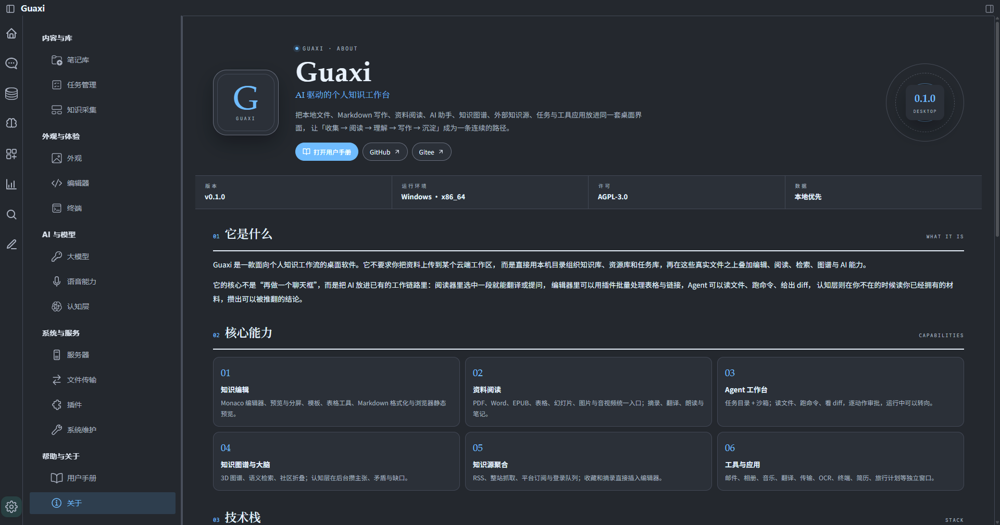

<div align="center">


# Guaxi

**AI 驱动的个人知识工作台** · 本地优先 · 桌面端

把本地文件、Markdown 写作、资料阅读、AI 助手、知识图谱、外部知识源、任务与工具应用
放进同一套桌面界面，让「收集 → 阅读 → 理解 → 写作 → 沉淀」成为一条连续的路径。

[](LICENSE)
[](https://github.com/xhcstar/Guaxi/releases)
[](https://tauri.app)
[](https://www.rust-lang.org)
[](https://vuejs.org)
[](#系统要求)

[核心能力](#核心能力) · [快速开始](#快速开始) · [使用方法](#使用方法) · [项目结构](#项目结构) · [开源致谢](#开源致谢) · [常见问题](#常见问题) · [许可证](#许可证)

</div>

---

## 它是什么

Guaxi 是一款面向**个人知识工作流**的桌面软件。它不要求你把资料上传到某个云端工作区，
而是直接用本机目录组织知识库、资源库和任务库，再在这些真实文件之上叠加编辑、阅读、检索、图谱与 AI 能力。

它的核心不是「再做一个聊天框」，而是把 AI 放进已有的工作链路里：

- 阅读器里选中一段，就能翻译、朗读或直接提问；
- 编辑器里可以用插件批量处理表格与链接，也能开一个浏览器静态预览看结果；
- Agent 可以读文件、跑命令、给出 diff，且每个动作都能先审批；
- 认知层在你不在的时候读你已经拥有的材料，攒出**可以被推翻**的结论。

一句话：**资料属于你，工具只是把它们串起来。**

## 设计原则

| 原则 | 具体做法 |
|---|---|
| **本地优先** | 知识库、资源库、任务库都是普通目录，随时可以用外部编辑器、Git 或文件管理器接管。没有强制云端。 |
| **AI 嵌入链路** | AI 以「选中即用」的方式出现在阅读、写作、检索、任务里，而不是要求你先切到聊天窗口。 |
| **桌面级能力** | 进程内语音模型、Python 插件、终端、SSH/SFTP、本地全文索引，不依赖额外的云端服务。 |
| **可审计、可撤回** | Agent 的每次读文件 / 跑命令 / 写文件都逐动作审批，运行中可以转向。 |
| **安静的后台** | 剪贴板与屏幕采集默认关闭；向量、新颖度与矛盾检测优先走本地模型。 |

## 核心能力

### 01 · 知识编辑

- **Monaco 编辑器**（VS Code 同款内核）：分屏预览、模板、表格工具、Markdown 格式化；
- 浏览器内静态预览、Excalidraw 白板、Mermaid / 数学公式 / 图表渲染；
- 编辑器插件体系（表单、表格、链接批处理），插件接口见 [`docs/plugin-api.md`](docs/plugin-api.md)。

### 02 · 资料阅读

- 统一入口解析 **PDF / Word / EPUB / Markdown / 表格 / 幻灯片 / 图片 / 音视频**；
- PDF 双引擎：`pdfium` 渲染 + `pdf-extract` 文本抽取，支持摘录、批注、双向定位（含 Typst 源码级 Synctex）；
- 摘录可直接插入编辑器，支持翻译、朗读（TTS）与阅读进度同步。

### 03 · Agent 工作台

- 任务目录 + 沙箱；读文件、跑命令、看 diff，**逐动作审批**；
- 双后端：Codex sidecar（可用时）与内置 Python Agent 服务（缺失时自动回退）；
- 支持运行中转向（steer）、命令书（command book）与工作区级权限边界。

### 04 · 知识图谱与「大脑」

- 3D 图谱、语义检索、社区折叠（Louvain）、图谱指标；
- 认知层在后台累积**主张 / 矛盾 / 缺口**，供你回头推翻或采信；
- 设计文档：[`docs/knowledge-graph-design.md`](docs/knowledge-graph-design.md)、[`docs/cognition-layer-design.md`](docs/cognition-layer-design.md)。

### 05 · 知识源聚合

- RSS / Atom、整站抓取、平台订阅与登录队列；
- 抓取后经质量、去重、分类流水线入库，收藏和摘录可直接插入编辑器；
- 设计文档：[`docs/design/flipboard-content-pipeline-v2.md`](docs/design/flipboard-content-pipeline-v2.md)。

### 06 · 工具与应用

独立窗口形态的效率工具集：邮件（IMAP / SMTP / EWS / Graph）、相册、音乐、
翻译、文件传输、OCR、终端（本地 / SSH / 串口）、简历、旅行计划、AI 影像工作室、
数据实验室、数学工作台、加密与证书工作台等。

### 07 · 检索与索引

- 正文全文检索：**Tantivy** 倒排索引 + **jieba** 中文分词（BM25 排序）；
- 文件名模糊匹配：**nucleo**（Helix 同款，路径感知打分）；
- 增量索引与文件监听（`notify`），支持摘录级搜索与预览。

## 界面预览

<div align="center">
  
  <p><sub>「关于」页：版本、能力矩阵、技术栈与许可信息</sub></p>
</div>

## 系统要求

| 项目 | 要求 |
|---|---|
| 操作系统 | **Windows 10/11 x64**（当前唯一完整验证并实际发布的主线） |
| 运行时 | WebView2（安装包已内嵌 bootstrapper，离线可装） |
| 构建：Node.js | 20 LTS 及以上（Vite 6 要求 Node 18+） |
| 构建：Rust | stable 工具链（Tauri 2 要求 1.77+，本项目在 stable 上构建） |
| 构建：C++ 工具链 | Visual Studio Build Tools（MSVC v143 + Windows SDK） |
| 构建：CI 之外 | Git；Windows 下 release 构建建议 ≥ 16 GB 内存（见[构建发布包](#5-构建发布包)） |

> Linux 配置（`tauri.linux.conf.json`，AppImage/deb/rpm）仍保留在仓库中，但打包布局与安装期解包尚未针对 deb/rpm 单独适配，改动前请先自行验证。macOS 未提供配置。

## 快速开始

### 1. 获取源码

```bash
git clone https://github.com/xhcstar/Guaxi.git
# 或：git clone https://github.com/xhcstar/Guaxi
cd Guaxi
```

### 2. 安装前端依赖

```bash
npm install     # postinstall 会自动复制 Excalidraw / Vditor 静态资源
```

### 3. 预取原生依赖（首次必需）

语音能力依赖 sherpa-onnx 的预编译原生库与模型。构建期**不允许联网下载**（很多构建机只有系统代理，Cargo 会卡死），
所以必须先预取到本地；`dev` / `build` 前编排层也会自动执行同一个脚本，失败即中止：

```bash
npm run sherpa:fetch        # 静态库 + 模型（Kokoro TTS / SenseVoice ASR / whisper / Silero VAD / 标点）
```

可选（缺失只降级，不阻断构建）：

```bash
npm run codex:fetch         # Codex sidecar（缺失则回退内置 Python Agent）
npm run rsshub:prepare      # RSSHub 运行环境（缺失则关闭聚合）
```

> 仓库不提交大二进制（`*.exe` / `*.dll` / 模型目录均在 `.gitignore` 中）。
> `src-tauri/utils` 下的 `pandoc.exe`、`tectonic`、`python_runtime`、`fonts`、`codex` 等随包资源需自行准备；
> 缺失时对应功能会降级或提示「资源缺失」，但**不影响编译**。

### 4. 开发模式

```bash
npm run tauri -- dev
```

编排层会先做依赖预取，再启动 Vite（`:1420`）+ Cargo（debug）。
debug 下**不复制、不打包** `utils`：运行时直接命中源码树 `src-tauri/utils`，改资源即时生效。

### 5. 构建发布包

```bash
npm run tauri -- build          # 完整 release 构建（推荐）
npm run tauri:build:reuse       # utils 未变时复用已有分包，省掉重扫十几万文件
```

构建完成后，**下面这些必须放在同一个目录一起分发**，少一个安装到一半就会中止：

```text
src-tauri/target/release/bundle/nsis/
├── guaxi_0.1.0_x64-setup.exe     # NSIS 安装器
├── extract_utils_bundles.exe     # 安装期解包 helper
├── README_utils_bundles.txt      # 分包清单（构建自动生成，发版核对用）
└── utils_bundles/                # 若干 *.tar.zst + bundle-manifest.json
```

### GPU（CUDA）构建

```bash
npm run sherpa:fetch:cuda      # 装配 CUDA 原生库与运行时（约 2 GB）
npm run tauri -- build -- --no-default-features --features gpu
```

`static`（CPU，默认，自包含无需分发 DLL）与 `shared`（GPU，动态链接 CUDA 运行库）互斥，
**GPU 构建必须带 `--no-default-features`**。发布目录还额外需要 `cuda_runtime_bundles/`。

### 常用脚本

| 脚本 | 说明 |
|---|---|
| `npm run dev` | 只起 Vite（不带 Tauri 壳） |
| `npm run build` | 构建前端到 `dist/`（末尾含阅读器分包检查） |
| `npm run prepare:tauri-utils` | 只重新生成 `utils` 分包，不构建安装器 |
| `npm run prepare:tauri-assets` | 单独复制 Excalidraw / Vditor 静态资源 |
| `npm run build:chart-preview` | 重新生成图表预览模块（被 Rust `include_str!` 打进二进制） |
| `npm run test:frontend` | 前端单测（`node --test`） |
| `npm run check:*` | 各类静态检查（搜索语法、窗口路由、离线图标、响应性等） |

### 构建为什么这么绕

安装包有硬上限：把数 GB 资源塞进 NSIS 会触发 `makensis` 的 `error mmapping datablock`（约 2 GB 数据块上限）。
所以 `utils` 被拆成外部的 `tar.zst` 分包，由专用 Rust helper 在安装阶段解包到安装目录，并支持增量跳过与完整性校验。

完整的阶段流程、分包规则、清单格式、排错表与「新增资源该改哪里」的决策表，都在
**[`docs/design/TAURI_BUILD_PIPELINE.md`](docs/design/TAURI_BUILD_PIPELINE.md)**。改构建链之前请先读它。

## 使用方法

### 首次启动

1. 「设置 → 笔记库」：指定**知识库根目录**、**文件库根目录**、**资源库根目录**，建议分开放置；
2. 「设置 → 任务管理」：指定**任务库根目录**，可一键初始化「工作 / 生活 / 学习」三个分类目录；
3. 「设置 → 大模型」：配置 AI 提供方——OpenAI 兼容接口，或本机 `llama.cpp` 后端（LocalDeepseek / LocalQwen）；
4. 「设置 → 语音能力」：确认模型已就位（随安装包分发，CPU 版开箱可用）；
5. 「设置 → 用户手册」：随时可查的完整使用说明。

### 工作区目录

Guaxi 不引入私有数据库格式，直接读写四类普通目录，每一类都可以单独指定：

| 目录 | 用途 | 未配置时的默认位置 |
|---|---|---|
| 知识库根目录 | 知识库数据 | 程序同级 `KnowledgeBases/` |
| 文件库根目录 | 导入的文件库数据 | 需手动选择 |
| 资源库根目录 | 截图、图片等资源 | 程序同级 `ResourceRepo/` |
| 任务库根目录 | 任务数据（`.org` 文件） | 程序同级 `task/` |

任务库根目录下会自动创建「工作 / 生活 / 学习」三个子目录（磁盘上用英文路径），并可作为
Git 仓库直接执行提交 / 推送 / 拉取——用的是你本机的 Git 配置与凭据。

这些目录可以用外部编辑器、`git` 或任意同步工具接管。移动或重命名后，请在设置中同步修改路径。

### 主要入口

| 入口 | 用途 |
|---|---|
| 知识编辑 | Monaco 写作、分屏预览、模板、表格工具 |
| 智能助手 | 多轮对话、附件与上下文引用 |
| 仓库 | 知识库 / 资源库管理、导入与转换 |
| 知识图谱 | 3D 图谱、语义检索、社区折叠 |
| 应用 | 邮件、相册、音乐、翻译、OCR、终端等独立工具 |
| 搜索 | 全文检索、文件名模糊匹配、摘录搜索 |
| 白板 | Excalidraw 绘图与导出 |
| 统计 | 阅读量、写作量与知识库概览 |
| 设置 → 用户手册 | **内置完整用户手册**（也可从「关于」页打开） |

### AI 配置

- **在线模型**：填写 OpenAI 兼容的 Base URL 与 API Key（内置 ChatGPT / DeepSeek / Qwen / Kimi / 豆包 / SiliconFlow 等预设），
  密钥在本机配置中加密保存（AES-256-GCM）；插件只能拿到补全结果，接触不到密钥；
- **本地模型**：走 `llama.cpp`，模型放在设置指定目录，全程不联网；
- **语音**：sherpa-onnx 进程内推理。GPU 版要求 `nvcuda.dll` 与 `onnxruntime_providers_cuda.dll` 同时存在，
  缺失会在构造引擎之前自动降级 CPU 并告警（而不是等到崩溃）；
- **邮箱账号**：口令与 OAuth Token 存放在系统凭据库（Windows Credential Manager）。

### 同步

四种方式分别配置，互不强制：

- **P2P（iroh）**：端到端直连，不经过中心服务器；
- **WebDAV**：挂到你已有的网盘；
- **Syncthing**：交给外部同步进程；
- **Git**：任务库可直接使用远程仓库。

同步范围按目录粒度配置（「设置 → 笔记库 → 同步引擎」），不是全盘同步。

## 数据与隐私

- **文件在你的磁盘上**：知识库、资源库、任务库都是普通目录；
- **模型密钥留在本机**：由软件保存并调用，插件接触不到密钥；
- **认知层默认安静**：剪贴板与屏幕采集出厂关闭，向量、新颖度与矛盾检测优先本地模型；
- **同步由你选择**：四种方式分别配置，不强制经过同一台服务器。

## 技术栈

| 层次 | 使用的东西 |
|---|---|
| 桌面壳与打包 | Rust、Tauri 2、NSIS、tar + zstd（外部资源分包） |
| 前端 | Vue 3、Vite 6、Pinia、Vue Router、Naive UI、Iconify |
| 编辑器与阅读 | Monaco Editor（含 languageclient / TextMate）、PDF.js、pdfium-render、docx-preview、EPUB.js、Vditor、Typst 0.14 |
| 内容解析 | anydoc、calamine、comrak、ebook-rs、pandoc（外置）、MinerU / marker（可选组件） |
| 图谱与可视化 | Graphology、d3-force-3d、ECharts、Excalidraw、Leaflet、Mermaid、Three.js |
| 检索 | Tantivy、tantivy-jieba、nucleo、rusqlite（FTS） |
| AI 与语音 | OpenAI 兼容接口、llama.cpp、sherpa-onnx（进程内 ASR/TTS）、Python 运行时（PyO3） |
| 系统与网络 | git2 / isomorphic-git、iroh（P2P）、russh + russh-sftp、polars、Reqwest、Actix Web（本地服务） |

## 项目结构

```text
guaxi/
├── src/                     # 前端（Vue 3）
│   ├── views/               # 页面级视图（首页/图谱/搜索/仓库/应用…）
│   ├── components/          # 组件（阅读器、编辑器、设置、应用窗口…）
│   ├── stores/              # Pinia 状态
│   ├── router/              # 路由与左侧导航声明
│   └── monaco/              # 编辑器内核与语言服务
├── src-tauri/               # 桌面端（Rust）
│   ├── src/commands/        # 按能力拆分的 Tauri 命令（阅读/转换/图谱/邮件/同步…）
│   ├── src/guaxiservices/   # 本地服务（内嵌 HTTP、LSP、语音、资源解析）
│   ├── src/bin/             # prepare_utils_zip / extract_utils_bundles / 各类自检
│   ├── utils/               # 随包资源（模型、字体、pandoc、python_runtime…）
│   ├── utils_zip_support.rs # 分包核心实现（扫描/拆分/压缩/清单/增量解包）
│   └── installer-hooks.nsh  # NSIS 安装钩子（解包资源 → CUDA → 字体）
├── agent_server/            # 内置 Python Agent 服务（FastAPI）
├── Convertor/               # 可选转换引擎（MinerU / marker / surya）
├── tools/                   # 构建编排与依赖预取脚本
├── GuaxiBrowserExtension/   # 浏览器扩展（登录态/剪藏）
├── docs/                    # 设计文档与用户手册来源
└── tests/                   # 前端单测（node --test）
```

## 项目信息

| 项目 | 内容 |
|---|---|
| 名称 | Guaxi（智能知识管理系统） |
| 版本 | v0.1.0（Preview，开发中） |
| 许可 | GNU Affero General Public License v3.0 |
| 主平台 | Windows 10/11 x64（NSIS 安装包） |
| 形态 | 本地优先的桌面应用，无强制云端依赖 |
| 源码 | [github.com/xhcstar/Guaxi](https://github.com/xhcstar/Guaxi) · [github.com/xhcstar/Guaxi](https://github.com/xhcstar/Guaxi) |
| 作者 / 维护者 | xhcstar |
| 打包标识 | `com.guaxi.guaxi` |
| 构建文档 | [`docs/design/TAURI_BUILD_PIPELINE.md`](docs/design/TAURI_BUILD_PIPELINE.md) |
| 用户手册 | 应用内「设置 → 用户手册」 |

## 开源致谢

Guaxi 建立在这些优秀项目之上（节选，按用途分组）：

| 项目 | 用途 | 许可 |
|---|---|---|
| [Tauri](https://tauri.app) | 桌面应用壳与打包 | Apache-2.0 / MIT |
| [Vue.js](https://vuejs.org) / [Vite](https://vite.dev) / [Pinia](https://pinia.vuejs.org) | 前端框架与构建 | MIT |
| [Naive UI](https://www.naiveui.com) | 组件库 | MIT |
| [Monaco Editor](https://microsoft.github.io/monaco-editor/) | 代码/Markdown 编辑器内核 | MIT |
| [PDF.js](https://mozilla.github.io/pdf.js/) | PDF 渲染 | Apache-2.0 |
| [pdfium-render](https://github.com/ajrcarey/pdfium-render) | PDF 渲染（Rust 绑定） | Apache-2.0 / MIT |
| [Excalidraw](https://excalidraw.com) | 白板 | MIT |
| [ECharts](https://echarts.apache.org) | 图表 | Apache-2.0 |
| [Graphology](https://graphology.github.io) | 图数据结构与社区检测 | MIT |
| [Typst](https://typst.app) | `.typ` → PDF 编译 | Apache-2.0 |
| [Pandoc](https://pandoc.org)（外置） | 文档格式转换 | GPL-2.0+ |
| [Tantivy](https://github.com/quickwit-oss/tantivy) + [jieba-rs](https://github.com/messense/jieba-rs) | 全文索引与中文分词 | MIT |
| [sherpa-onnx](https://github.com/k2-fsa/sherpa-onnx) | 本地语音识别与合成 | Apache-2.0 |
| [llama.cpp](https://github.com/ggml-org/llama.cpp) | 本地大模型推理 | MIT |
| [iroh](https://iroh.computer) | P2P 同步 | Apache-2.0 / MIT |
| [Vditor](https://github.com/Vanessa219/vditor) | Markdown 编辑器 | MIT |
| [Leaflet](https://leafletjs.com) | 地图渲染 | BSD-2-Clause |
| [RSSHub](https://docs.rsshub.app)（外置） | 订阅源构建 | MIT |
| [Marker](https://github.com/datalab-to/marker) / [MinerU](https://github.com/opendatalab/MinerU) / [Surya](https://github.com/datalab-to/surya)（可选组件） | 高精度文档解析 | 见各自仓库 |

> 上表为便于阅读的节选；完整依赖清单见 `package.json`、`src-tauri/Cargo.lock` 与 `agent_server/requirements.txt`。
> 各依赖的许可证以对应项目的 LICENSE 为准。**注意 Pandoc、MinerU、marker 等为 GPL/AGPL 系列，
> 若你分发包含它们的一体化安装包，请自行核对许可义务。**

## 常见问题

| 现象 | 原因 / 处理 |
|---|---|
| 安装到一半弹「解压外部 utils 资源包失败」 | 发布目录缺 `utils_bundles/` 或 `bundle-manifest.json`，或与安装器不同版本；必须整目录一起分发 |
| 改了 `utils` 里的文件，打出来的包没更新 | 用了 `tauri:build:reuse`——它不重扫 `utils`；改跑 `npm run prepare:tauri-utils` 或完整 build |
| `cargo` 卡在下载 sherpa 原生库 | 预取没成功，`build.rs` 回去联网了；重跑 `npm run sherpa:fetch` |
| `error mmapping datablock` | 又把大资源塞进了 `bundle.resources`；走外置分包 |
| dev 下报「资源缺失」但文件明明在 | 代码绕过了 `ensure_relative_dir()` 自拼路径；统一走该入口 |
| GPU 版实际还在跑 CPU | 缺 CUDA 运行时 DLL 或驱动过旧；`npm run sherpa:fetch:cuda` 后重打，看自检退出码 |

完整排错表见构建文档的 [第 11 章](docs/design/TAURI_BUILD_PIPELINE.md#11-排错速查)。

## 贡献

- **问题反馈 / 功能建议**：请走仓库 Issues，附上版本号、系统版本与复现步骤；
- **代码贡献**：提交前请至少跑通 `npm run test:frontend` 与 `npm run build`；
- **构建相关改动**：必须同步更新 [`docs/design/TAURI_BUILD_PIPELINE.md`](docs/design/TAURI_BUILD_PIPELINE.md)；
- **新增随包资源**：先读构建文档第 10 章（决策表 + 四种情形），不要把大资源塞进 `bundle.resources`。

## 许可证

本项目以 **GNU Affero General Public License v3.0（AGPL-3.0）** 发布，完整条款见 [LICENSE](LICENSE)。

这意味着你可以自由使用、修改和分发本软件；但如果你修改后**作为网络服务提供给他人使用**，
必须以同一许可公开对应的源代码。

---

<div align="center">
<sub>Guaxi · 智能知识管理系统 · Built with Rust &amp; Vue · AGPL-3.0</sub><br/>
<sub>© 2026 Guaxi. 资料属于你，工具只是把它们串起来。</sub>
</div>
