<div align="center">


# Guaxi

**An AI-native personal knowledge workspace** · Local-first · Cross-platform desktop

Guaxi gathers local files, Markdown writing, document reading, an AI agent, a knowledge graph,
external feeds, tasks and utility apps into a single desktop surface — so that
*collect → read → understand → write → distill* becomes one continuous path.

**English** · [简体中文](README.zh-CN.md)

[](LICENSE)
[](https://github.com/xhcstar/Guaxi/releases)
[](https://tauri.app)
[](https://www.rust-lang.org)
[](https://vuejs.org)
[](#system-requirements)

[Core capabilities](#core-capabilities) · [Quick start](#quick-start) · [Usage](#usage) · [Project layout](#project-layout) · [Acknowledgements](#acknowledgements) · [FAQ](#faq) · [License](#license)

</div>

---

## What it is

Guaxi is a desktop application for **personal knowledge work**. It does not ask you to upload your
material into some cloud workspace. It organizes your knowledge base, resource library and task
library as ordinary directories on your own disk, then layers editing, reading, search, graphs and AI
on top of those real files.

The point is not another chat window. The point is putting AI inside the workflow you already have:

- select a passage in the reader and translate it, have it read aloud, or ask about it;
- process tables and links in the editor with plugins, or open a static browser preview to check the result;
- let the agent read files, run commands and produce diffs — with every action approved first;
- let the cognition layer read material you already own while you are away and accumulate conclusions **you can overturn**.

In one line: **the material is yours; the tools just connect it.**

## Design principles

| Principle | What that means in practice |
|---|---|
| **Local-first** | Knowledge, resource and task libraries are plain directories — an external editor, Git or your file manager can take over at any time. No mandatory cloud. |
| **AI inside the workflow** | AI appears where you already are — reading, writing, search, tasks — as *select and act*, not as "switch to a chat window first". |
| **Desktop-grade capability** | In-process speech models, Python plugins, terminal, SSH/SFTP, local full-text index. No extra cloud service required. |
| **Auditable, reversible** | Every agent file read, shell command and file write is approved per action, and you can steer while it runs. |
| **Quiet by default** | Clipboard and screen capture are off out of the box; embeddings, novelty and contradiction detection prefer local models. |

## Core capabilities

### 01 · Knowledge editing

- **Monaco editor** (the same core as VS Code): split preview, templates, table tools, Markdown formatting;
- In-app static browser preview, Excalidraw whiteboard, Mermaid / math / chart rendering;
- Editor plugin system (forms, tables, bulk link handling); see [`docs/plugin-api.md`](docs/plugin-api.md).

### 02 · Document reading

- One entry point for **PDF / Word / EPUB / Markdown / spreadsheets / slides / images / audio & video**;
- Dual PDF engines: `pdfium` for rendering plus `pdf-extract` for text, with excerpts, annotations and
  bidirectional location (including source-level SyncTeX for Typst);
- Excerpts drop straight into the editor, with translation, text-to-speech and reading-progress sync.

### 03 · Agent workspace

- Task directory plus sandbox; read files, run commands, inspect diffs — **approved per action**;
- Two backends: a Codex sidecar when available, and a built-in Python agent service as automatic fallback;
- Mid-run steering, a command book, and workspace-level permission boundaries.

### 04 · Knowledge graph and the "brain"

- 3D graph, semantic search, community folding (Louvain), graph metrics;
- The cognition layer accumulates **claims, contradictions and gaps** in the background for you to overturn or accept;
- Design notes: [knowledge graph](docs/knowledge-graph-design.md), [cognition layer](docs/cognition-layer-design.md).

### 05 · Feed aggregation

- RSS / Atom, full-site crawling, platform subscriptions and a login queue;
- Items pass a quality, dedup and classification pipeline before landing in the library; bookmarks and excerpts insert straight into the editor;
- Design note: [`docs/design/flipboard-content-pipeline-v2.md`](docs/design/flipboard-content-pipeline-v2.md).

### 06 · Tools and apps

Standalone-window utilities: mail (IMAP / SMTP / EWS / Graph), photo album, music, translation,
file transfer, OCR, terminal (local / SSH / serial), résumé, trip planner, AI imaging studio,
data lab, math workbench, crypto and certificate workbench, and more.

### 07 · Search and indexing

- Full-text body search: **Tantivy** inverted index with **jieba** Chinese segmentation (BM25 ranking);
- Fuzzy filename matching: **nucleo** (the matcher behind Helix, path-aware scoring);
- Incremental indexing and file watching (`notify`), with excerpt-level search and preview.

## Screenshots

Every screenshot below comes from the in-app manual (*Settings → User manual*). Each view is shown in
both light and dark themes, matching the theme the app is currently using.

| View | Light | Dark |
|:--|:-:|:-:|
| **Knowledge editing**<br/>Multi-tab Markdown, outline tree, live preview | 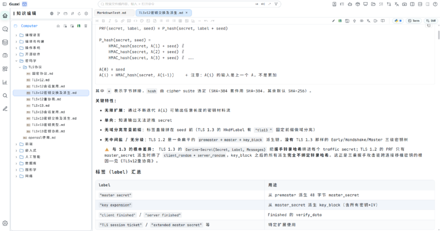 | 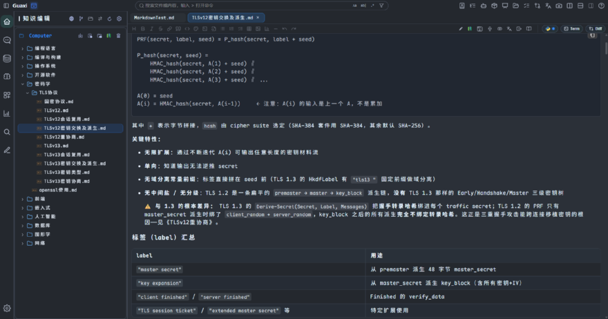 |
| **Agent workspace**<br/>Task directory, tool calls, run ledger, side panel | 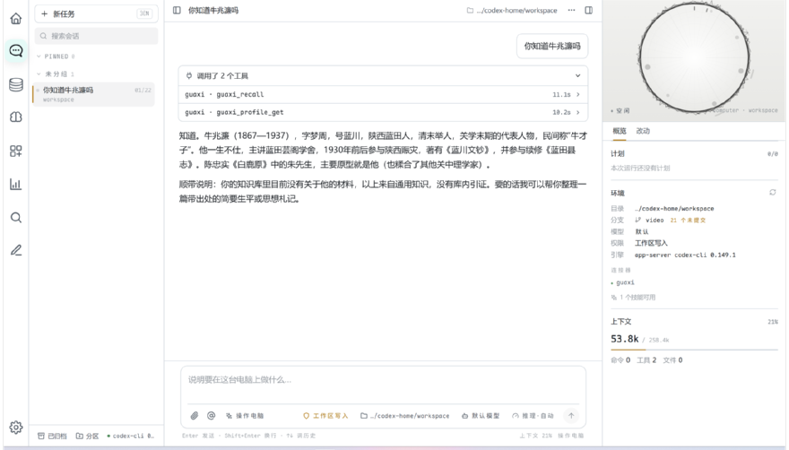 | 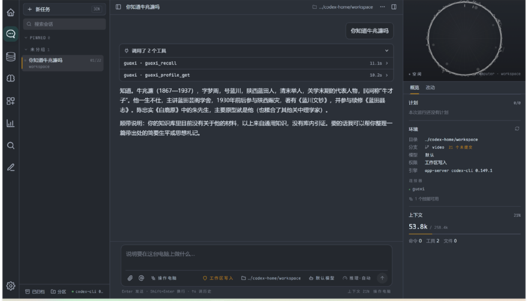 |
| **Library · shelf**<br/>Knowledge-base filters and document covers | 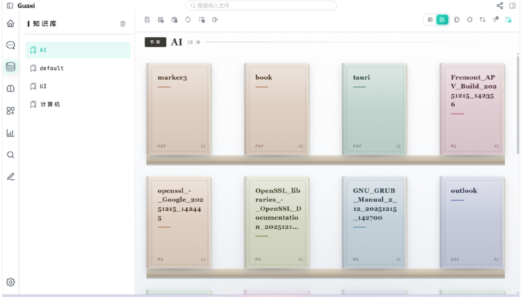 | 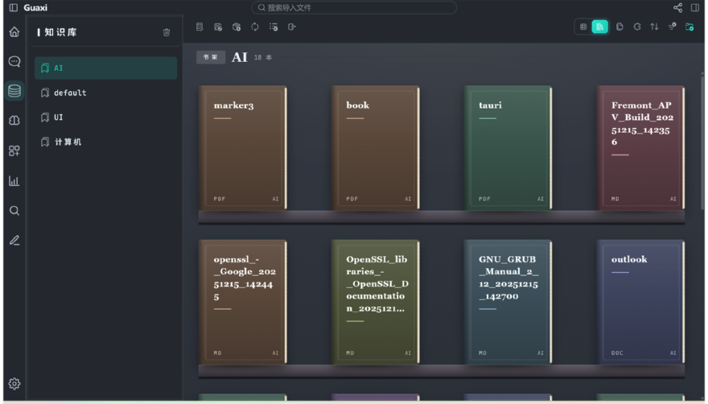 |
| **Feeds**<br/>Categories, article stream, bookmarks | 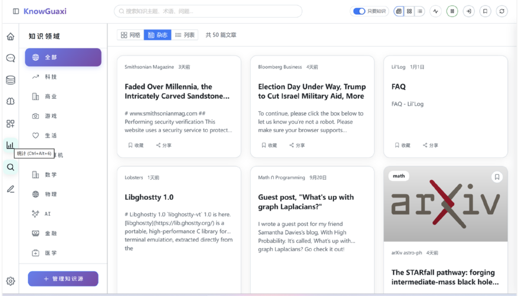 | 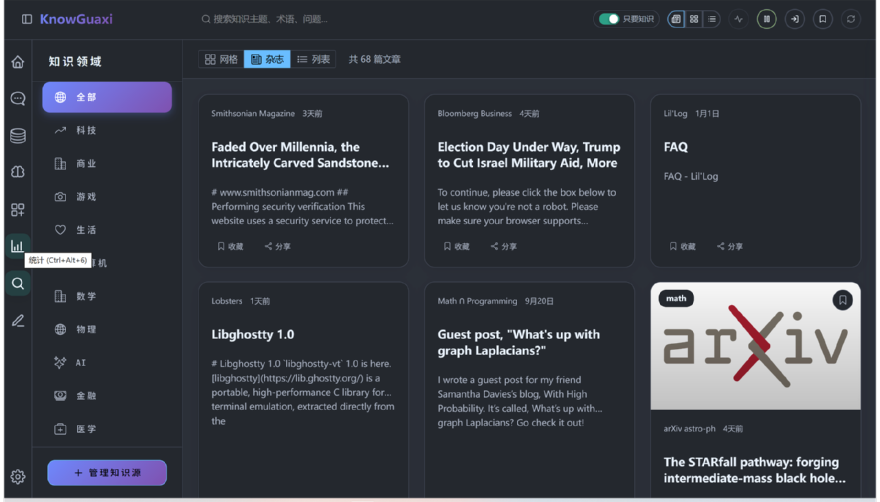 |
| **Brain · cognition layer**<br/>Daily brief, reminders, inbox | 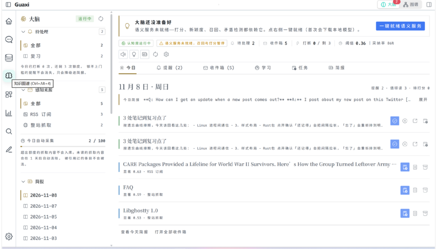 | 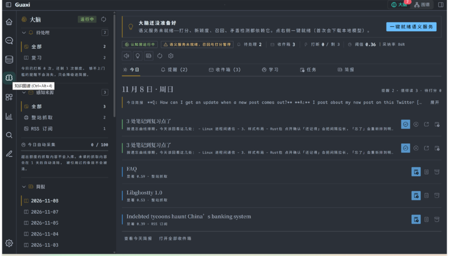 |

Formulas and charts inside the editor are rendered locally as block-level elements, with no external service:

| Math | Charts |
|:-:|:-:|
| 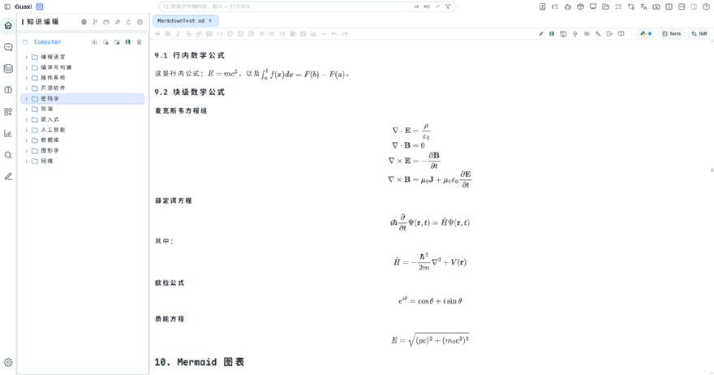 | 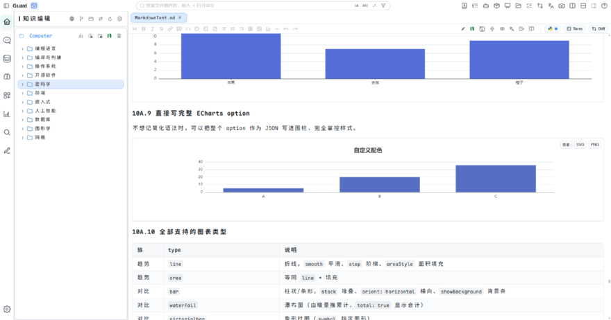 |
| Inline and block LaTeX, rendered by Vditor's built-in KaTeX | ECharts with custom `option` and SVG / PNG export |

## System requirements

| Item | Requirement |
|---|---|
| OS (Windows) | Windows 10/11 x64 — the fully verified, shipping mainline |
| OS (Linux) | Linux x64 — packaging config is in place (AppImage / deb / rpm), adaptation still in progress |
| WebView runtime | Windows: WebView2 (bootstrapper embedded in the installer, works offline) · Linux: WebKitGTK |
| Build: Node.js | 20 LTS or newer (Vite 6 needs Node 18+) |
| Build: Rust | stable toolchain (Tauri 2 requires 1.77+; this project builds on stable) |
| Build: C++ toolchain | Windows: Visual Studio Build Tools (MSVC v143 + Windows SDK) |
| Build: Linux packages | `webkit2gtk-4.1`, `gtk3`, `librsvg2`, `patchelf` and friends — see the [Tauri prerequisites](https://tauri.app/start/prerequisites/) |
| Build: other | Git; on Windows allow ≥ 16 GB RAM for a release build (see [Build the release bundle](#5-build-the-release-bundle)) |

> **Platform status**
>
> - **Windows** is the mainline that is fully verified and actually shipped today. The installer is NSIS,
>   and large assets travel as external `tar.zst` bundles.
> - **Linux** is a supported target: `tauri.linux.conf.json` already configures AppImage / deb / rpm
>   packaging, and resources are handled differently — `utils/__bundles` ships *inside* the package as
>   resources and is extracted on first launch, so no external helper is involved. What is still being
>   finished is **per-distribution verification of the installed directory layout and runtime path
>   resolution**. Bug reports with logs are welcome.
> - **macOS** has no build configuration.

## Quick start

### 1. Get the source

```bash
git clone https://github.com/xhcstar/Guaxi.git
cd Guaxi
```

### 2. Install frontend dependencies

```bash
npm install     # postinstall copies the Excalidraw / Vditor static assets
```

### 3. Prefetch native dependencies (required once)

Speech features depend on prebuilt sherpa-onnx native libraries and models. The build **must not
download anything at build time** (many build machines only have a system proxy, which makes Cargo
hang), so fetch them locally first. The `dev` / `build` orchestration runs the same script and aborts
on failure:

```bash
npm run sherpa:fetch        # static libs + models (Kokoro TTS / SenseVoice ASR / whisper / Silero VAD / punctuation)
```

Optional — a missing piece only degrades a feature, it never blocks the build:

```bash
npm run codex:fetch         # Codex sidecar (falls back to the built-in Python agent)
npm run rsshub:prepare      # RSSHub runtime (feed aggregation stays off without it)
```

> Large binaries are not committed (`*.exe`, `*.dll` and model directories are all in `.gitignore`).
> The bundled assets under `src-tauri/utils` — `pandoc.exe`, `tectonic`, `python_runtime`, `fonts`,
> `codex` — are yours to provide. When they are missing the related feature degrades or reports a
> missing resource, but **compilation still succeeds**.

### 4. Development mode

There is exactly one entry point for Tauri: `npm run tauri -- <subcommand>` (`dev` / `build` / `bundle`).
`tools/run_tauri_with_utils.mjs` prefetches dependencies and prepares resources before invoking Tauri,
and passes extra arguments through unchanged after the subcommand.

```bash
npm run tauri -- dev
```

The orchestration prefetches dependencies first, then starts Vite (`:1420`) and Cargo (debug).
Debug builds **do not copy or bundle** `utils`: the app reads `src-tauri/utils` straight from the
source tree, so resource edits take effect immediately.

### 5. Build the release bundle

```bash
npm run tauri -- build                        # full release build (recommended)
npm run tauri -- build --reuse-utils-zip      # reuse existing bundles when utils is unchanged
```

**Windows (NSIS, mainline)** — everything below must be distributed **together in one directory**;
leave one out and the installer aborts halfway through:

```text
src-tauri/target/release/bundle/nsis/
├── guaxi_0.1.1_x64-setup.exe     # NSIS installer
├── extract_utils_bundles.exe     # install-time extraction helper
├── README_utils_bundles.txt      # bundle manifest (generated at build time, for release checks)
└── utils_bundles/                # *.tar.zst files + bundle-manifest.json
```

**Linux (AppImage / deb / rpm, in progress)** — same command; artifacts land in
`src-tauri/target/release/bundle/{appimage,deb,rpm}/`. Resource handling differs from Windows:
`utils/__bundles/` is **embedded in the package as resources** and extracted into `utils/` on first
launch, so there is **no** external helper and no `utils_bundles/` directory — the installer itself is
a complete, distributable file.

### GPU (CUDA) build

```bash
npm run sherpa:fetch:cuda      # assemble CUDA native libs and runtime (~2 GB)
npm run tauri -- build -- --no-default-features --features gpu
```

CPU and GPU builds keep **separate Cargo target directories** (`src-tauri/target` vs
`src-tauri/target-gpu`) so switching between the two feature sets never invalidates the other
one's incremental cache. GPU artifacts therefore land under `src-tauri/target-gpu/release/`
(with the same `bundle/nsis/` layout plus an extra `cuda_runtime_bundles/`).

`static` (CPU, the default: self-contained, no DLLs to ship) and `shared` (GPU: dynamically linked
against the CUDA runtime) are mutually exclusive, so **GPU builds must pass `--no-default-features`**.
A Windows release directory additionally needs `cuda_runtime_bundles/`.

### Common scripts

| Script | Description |
|---|---|
| `npm run tauri -- <dev\|build\|bundle>` | Unified Tauri entry (prefetches dependencies and prepares resources) |
| `npm run tauri:gpu` | GPU dev mode (shortcut for `dev --no-default-features --features gpu`) |
| `npm run dev` | Vite only (no Tauri shell) |
| `npm run build` | Build the frontend into `dist/` (ends with a reader chunk check) |
| `npm run prepare:tauri-utils` | Regenerate the `utils` bundles without building an installer |
| `npm run prepare:tauri-assets` | Copy the Excalidraw / Vditor static assets only |
| `npm run build:chart-preview` | Regenerate the chart preview module (`include_str!`-ed into the binary) |
| `npm run test:frontend` | Frontend unit tests (`node --test`) |
| `npm run check:*` | Static checks (search syntax, window routing, offline icons, responsiveness, …) |

### Why the build looks like this

Windows installers have a hard ceiling: pushing gigabytes of assets into NSIS trips
`error mmapping datablock` in `makensis` (roughly a 2 GB datablock limit). So on Windows the `utils`
tree is split into external `tar.zst` bundles, extracted at install time by a dedicated Rust helper
that supports incremental skipping and integrity checks. Linux has no such limit: the bundles ship as
resources and are extracted on first launch.

The full stage pipeline, bundling rules, manifest format, troubleshooting table and the "where do I
change things when adding an asset" decision table live in
**[`docs/design/TAURI_BUILD_PIPELINE.md`](docs/design/TAURI_BUILD_PIPELINE.md)** (written in Chinese).
Read it before touching the build chain.

## Usage

### First launch

1. **Settings → Note library**: choose the **knowledge base**, **file library** and **resource library**
   roots — separate locations are recommended;
2. **Settings → Task manager**: choose the **task library root**; one click initializes the
   `Work / Life / Study` categories;
3. **Settings → LLM**: configure a provider — any OpenAI-compatible endpoint, or a local `llama.cpp`
   backend (LocalDeepseek / LocalQwen);
4. **Settings → Speech**: confirm the models are in place (shipped with the installer; the CPU build
   works out of the box);
5. **Settings → User manual**: the complete manual, available at any time.

### Workspace directories

Guaxi introduces no proprietary database format. It reads and writes four kinds of plain directories,
each configurable on its own:

| Directory | Purpose | Default when unset |
|---|---|---|
| Knowledge base root | Knowledge base data | `KnowledgeBases/` next to the executable |
| File library root | Imported file library | Must be chosen manually |
| Resource library root | Screenshots, images and other assets | `ResourceRepo/` next to the executable |
| Task library root | Task data (`.org` files) | `task/` next to the executable |

`Work / Life / Study` subdirectories (English paths on disk) are created automatically under the task
library root, which can itself be a Git repository — commit, push and pull use your local Git
configuration and credentials.

Any of these directories can be handed over to an external editor, `git` or any sync tool. If you move
or rename one, update the path in Settings.

### Main entry points

| Entry | Purpose |
|---|---|
| Knowledge editing | Monaco writing, split preview, templates, table tools |
| Assistant | Multi-turn chat, attachments and context references |
| Library | Knowledge / resource library management, import and conversion |
| Knowledge graph | 3D graph, semantic search, community folding |
| Apps | Mail, album, music, translation, OCR, terminal and other standalone tools |
| Search | Full-text search, fuzzy filename matching, excerpt search |
| Whiteboard | Excalidraw drawing and export |
| Statistics | Reading, writing and knowledge-base overview |
| Settings → User manual | **The complete built-in manual** (also reachable from *About*) |

### AI configuration

- **Online models**: any OpenAI-compatible Base URL and API key (presets for ChatGPT / DeepSeek / Qwen /
  Kimi / Doubao / SiliconFlow). Keys are stored encrypted in the local config (AES-256-GCM); plugins
  only ever see completion results, never the key;
- **Local models**: `llama.cpp`, models in a directory you choose, fully offline;
- **Speech**: in-process sherpa-onnx inference. The GPU build requires both `nvcuda.dll` and
  `onnxruntime_providers_cuda.dll`; if either is missing it degrades to CPU with a warning *before* the
  engine is constructed, rather than failing later;
- **Mail accounts**: passwords and OAuth tokens go to the system credential store
  (Windows Credential Manager / Linux Secret Service).

### Sync

Four independent options — configure whichever you need:

- **P2P (iroh)**: direct end to end, no central server;
- **WebDAV**: point it at a drive you already have;
- **Syncthing**: hand it to an external sync process;
- **Git**: the task library can use a remote repository directly.

Sync scope is configured per directory (*Settings → Note library → Sync engine*), not as a whole-disk sync.

## Data and privacy

- **Your files stay on your disk**: knowledge, resource and task libraries are plain directories;
- **Model keys stay on your machine**: the app stores and uses them, plugins cannot reach them;
- **The cognition layer is quiet by default**: clipboard and screen capture ship disabled, and
  embeddings, novelty and contradiction detection prefer local models;
- **Sync is your choice**: four options, each configured separately, with no single mandatory server.

## Tech stack

| Layer | What we use |
|---|---|
| Desktop shell & packaging | Rust, Tauri 2, NSIS (Windows) / AppImage · deb · rpm (Linux), tar + zstd (asset bundles) |
| Frontend | Vue 3, Vite 6, Pinia, Vue Router, Naive UI, Iconify |
| Editing & reading | Monaco Editor (with languageclient / TextMate), PDF.js, pdfium-render, docx-preview, EPUB.js, Vditor, Typst 0.14 |
| Content parsing | anydoc, calamine, comrak, ebook-rs, pandoc (external), MinerU / marker (optional) |
| Graph & visualization | Graphology, d3-force-3d, ECharts, Excalidraw, Leaflet, Mermaid, Three.js |
| Search | Tantivy, tantivy-jieba, nucleo, rusqlite (FTS) |
| AI & speech | OpenAI-compatible APIs, llama.cpp, sherpa-onnx (in-process ASR/TTS), Python runtime (PyO3) |
| System & network | git2 / isomorphic-git, iroh (P2P), russh + russh-sftp, polars, Reqwest, Actix Web (local services) |

## Project layout

```text
guaxi/
├── src/                     # Frontend (Vue 3)
│   ├── views/               # Page-level views (home / graph / search / library / apps …)
│   ├── components/          # Components (reader, editor, settings, app windows …)
│   ├── stores/              # Pinia state
│   ├── router/              # Routes and sidebar navigation declarations
│   └── monaco/              # Editor core and language services
├── src-tauri/               # Desktop side (Rust)
│   ├── src/commands/        # Tauri commands split by capability (reading / conversion / graph / mail / sync …)
│   ├── src/guaxiservices/   # Local services (embedded HTTP, LSP, speech, asset resolution)
│   ├── src/bin/             # prepare_utils_zip / extract_utils_bundles / self-checks
│   ├── utils/               # Bundled assets (models, fonts, pandoc, python_runtime …)
│   ├── utils_zip_support.rs # Bundle core (scan / split / compress / manifest / incremental extract)
│   └── installer-hooks.nsh  # NSIS install hooks (extract assets → CUDA → fonts)
├── agent_server/            # Built-in Python agent service (FastAPI)
├── Convertor/               # Optional conversion engines (MinerU / marker / surya)
├── tools/                   # Build orchestration and dependency prefetch scripts
├── GuaxiBrowserExtension/   # Browser extension (session / clipping)
├── docs/                    # Design documents and manual sources
└── tests/                   # Frontend unit tests (node --test)
```

## Project information

| Item | Value |
|---|---|
| Name | Guaxi (intelligent knowledge management system) |
| Version | v0.1.1 (preview, in development) |
| License | GNU Affero General Public License v3.0 |
| Platforms | Windows 10/11 x64 (mainline, NSIS) · Linux x64 (AppImage / deb / rpm, in progress) |
| Form | Local-first desktop application, no mandatory cloud dependency |
| Source | [github.com/xhcstar/Guaxi](https://github.com/xhcstar/Guaxi) |
| Author / maintainer | xhcstar |
| Bundle identifier | `com.guaxi.guaxi` |
| Build docs | [`docs/design/TAURI_BUILD_PIPELINE.md`](docs/design/TAURI_BUILD_PIPELINE.md) |
| User manual | In-app *Settings → User manual* |

## Acknowledgements

Guaxi stands on these projects (a selection, grouped by role):

| Project | Role | License |
|---|---|---|
| [Tauri](https://tauri.app) | Desktop shell and packaging | Apache-2.0 / MIT |
| [Vue.js](https://vuejs.org) / [Vite](https://vite.dev) / [Pinia](https://pinia.vuejs.org) | Frontend framework and build | MIT |
| [Naive UI](https://www.naiveui.com) | Component library | MIT |
| [Monaco Editor](https://microsoft.github.io/monaco-editor/) | Code / Markdown editor core | MIT |
| [PDF.js](https://mozilla.github.io/pdf.js/) | PDF rendering | Apache-2.0 |
| [pdfium-render](https://github.com/ajrcarey/pdfium-render) | PDF rendering (Rust bindings) | Apache-2.0 / MIT |
| [PDFium](https://pdfium.googlesource.com/pdfium/) | PDF rendering engine (runtime library) | BSD-3-Clause |
| [Excalidraw](https://excalidraw.com) | Whiteboard | MIT |
| [ECharts](https://echarts.apache.org) | Charts | Apache-2.0 |
| [Graphology](https://graphology.github.io) | Graph data structures and community detection | MIT |
| [Typst](https://typst.app) | `.typ` → PDF compilation | Apache-2.0 |
| [Pandoc](https://pandoc.org) (external) | Document format conversion | GPL-2.0+ |
| [Tantivy](https://github.com/quickwit-oss/tantivy) + [jieba-rs](https://github.com/messense/jieba-rs) | Full-text index and Chinese segmentation | MIT |
| [sherpa-onnx](https://github.com/k2-fsa/sherpa-onnx) | Local speech recognition and synthesis | Apache-2.0 |
| [llama.cpp](https://github.com/ggml-org/llama.cpp) | Local LLM inference | MIT |
| [iroh](https://iroh.computer) | P2P sync | Apache-2.0 / MIT |
| [Vditor](https://github.com/Vanessa219/vditor) | Markdown editor | MIT |
| [Leaflet](https://leafletjs.com) | Map rendering | BSD-2-Clause |
| [RSSHub](https://docs.rsshub.app) (external) | Feed construction | MIT |
| [Marker](https://github.com/datalab-to/marker) / [MinerU](https://github.com/opendatalab/MinerU) / [Surya](https://github.com/datalab-to/surya) (optional) | High-accuracy document parsing | See each repository |

> The table above is a readable selection; the full dependency list lives in `package.json`,
> `src-tauri/Cargo.lock` and `agent_server/requirements.txt`. Each dependency is governed by its own
> LICENSE. **Note that Pandoc, MinerU, marker and friends are GPL/AGPL — if you distribute a combined
> installer that includes them, verify the licensing obligations yourself.**

## FAQ

| Symptom | Cause / fix |
|---|---|
| Installer aborts with "failed to extract external utils bundles" (Windows) | `utils_bundles/` or `bundle-manifest.json` is missing from the release directory, or its version does not match the installer — ship the whole directory together |
| Installer seems frozen while extracting assets | Expected for a few minutes (gigabytes). Check **Show details**: it streams `[utils.bundle]` progress lines, and the same log is saved to `install.log` in the install directory |
| Extracted assets fail with "目标目录不可写" / "磁盘空间不足" | Permission or antivirus block on the install directory, or too little free space; the helper checks writability and free space before touching any file |
| Edited files under `utils` but the built package is unchanged | You used `--reuse-utils-zip`, which does not rescan `utils`; rerun `npm run prepare:tauri-utils` or do a full build |
| `cargo` hangs downloading the sherpa native libs | The prefetch failed and `build.rs` went online; rerun `npm run sherpa:fetch` |
| `error mmapping datablock` (Windows) | Large assets were pushed back into `bundle.resources`; use the external bundles |
| Resources reported missing after a Linux install | Check that `utils/__bundles` was packaged as resources. First launch extracts it and writes `.guaxi_utils_extract_complete` next to `utils`; leftover `utils.__extracting_*` directories are resumed or cleaned up on the next launch |
| "Resource missing" in dev although the files are clearly there | Code built the path by hand instead of going through `ensure_relative_dir()`; route it through that entry point |
| GPU build still runs on CPU | CUDA runtime DLLs missing or the driver is outdated; rerun `npm run sherpa:fetch:cuda`, rebuild, and check the self-check exit code |
| Build appears frozen during packaging | It is usually the `utils` scan/compression or `makensis`; the wrapper prints a stage header, progress lines and a 20 s heartbeat. Silence longer than a heartbeat with no CPU use means a real hang. See [build log guide](docs/design/TAURI_BUILD_PIPELINE.md#64-构建日志怎么读) (Chinese) |

The complete troubleshooting table is [chapter 11 of the build doc](docs/design/TAURI_BUILD_PIPELINE.md#11-排错速查) (Chinese).

## Contributing

- **Bugs / feature requests**: open an issue and include the version, OS and reproduction steps;
- **Code**: run at least `npm run test:frontend` and `npm run build` before submitting;
- **Build-related changes**: update [`docs/design/TAURI_BUILD_PIPELINE.md`](docs/design/TAURI_BUILD_PIPELINE.md) in the same change;
- **New bundled assets**: read chapter 10 of the build doc first (decision table plus four cases), and do not push large assets into `bundle.resources`.

## License

Released under the **GNU Affero General Public License v3.0 (AGPL-3.0)**. The full text is in [LICENSE](LICENSE).

You are free to use, modify and distribute this software; but if you modify it and **offer it to
others as a network service**, you must publish the corresponding source under the same license.

---

<div align="center">
<sub>Guaxi · Intelligent knowledge management · Built with Rust &amp; Vue · AGPL-3.0</sub><br/>
<sub>© 2026 Guaxi. Your material is yours; the tools just connect it.</sub>
</div>
