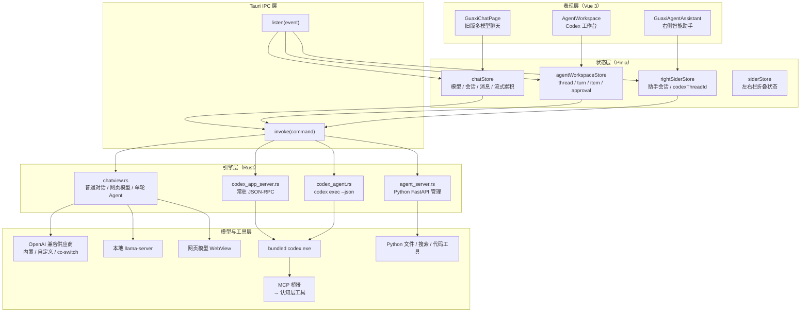
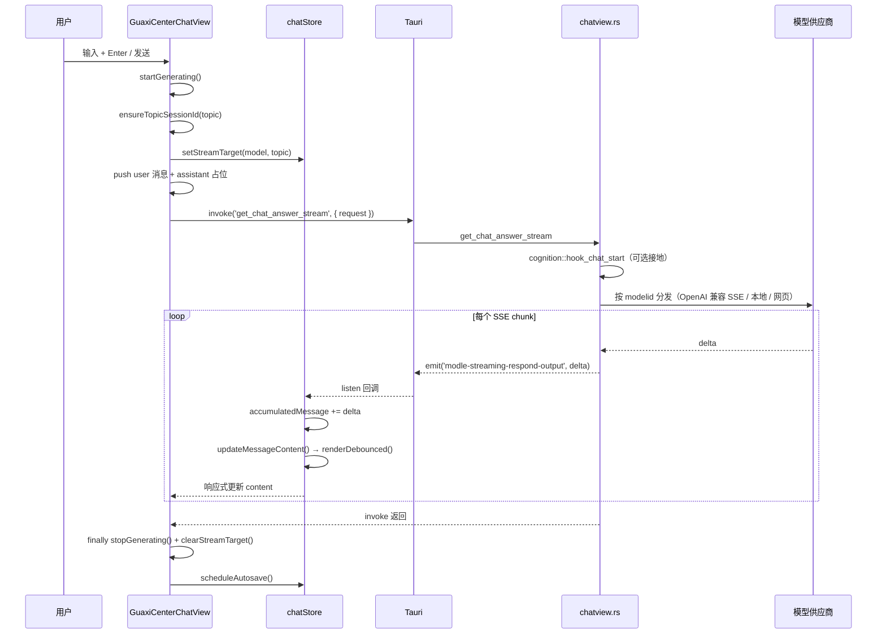
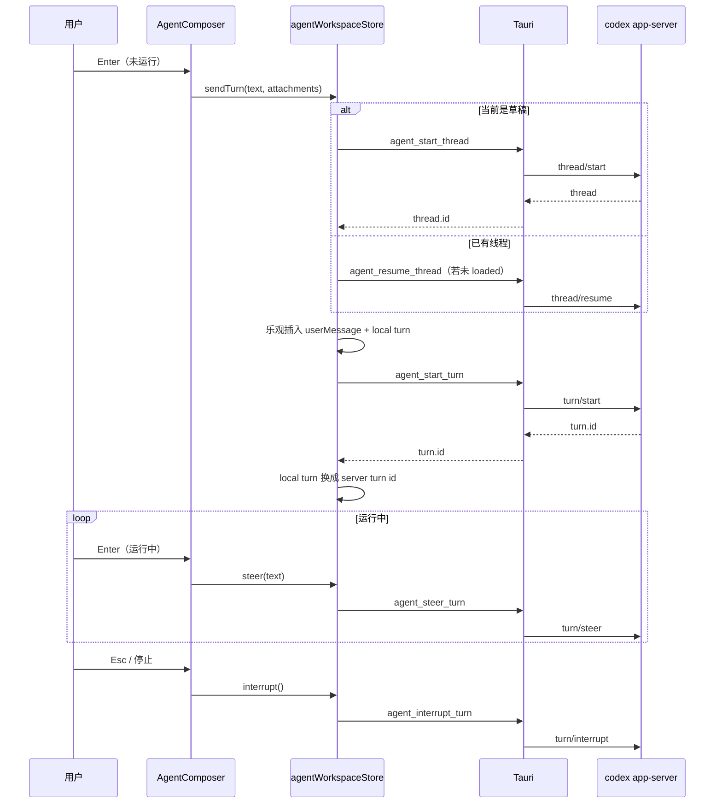

# Guaxi 聊天页 Agent 架构设计

> 代码基线：`main` @ `7e64ee39`
> 涉及页面：`src/views/GuaxiChatPage.vue`（旧版聊天）、`src/views/GuaxiAgentWorkspacePage.vue`（现行 `/chat` 工作台）
> 本文所有命令名、事件名、字段名均可在源码中检索到；路径后的行号用于快速定位。

---

## 0. 先厘清：当前存在两个“聊天页”

`GuaxiChatPage.vue` 仍是多模型闲聊页，但导航里的 `/chat` 已经切到 Agent 工作台：

| 路由 | 宿主页面 | 定位 | 是否有 Agent 能力 |
|---|---|---|---|
| `/chat` | `GuaxiAgentWorkspacePage.vue` → `AgentWorkspace.vue` | Codex 工作台：会话 / 转录 / 仪表三段式 | 有，直接驱动 codex app-server |
| `/chat-legacy` | `GuaxiChatPage.vue` → Header + Content | 旧版多模型对话：远程模型、本地模型、网页模型 | 没有工具调用；走普通流式对话链路 |
| 右侧智能助手 | `HomeViewComponent/GuaxiAgentAssistant.vue` | 文档/知识库旁的助手侧栏 | 有，走单轮 `agent_chat_stream` |

因此本文分三部分写：

1. `GuaxiChatPage.vue` 这一套旧版聊天页的真实实现；
2. 现行 `/chat` 工作台的 Agent 组织方式；
3. 两种 Agent 引擎（codex app-server / codex exec）以及 Python 回退引擎的接入细节。

---

## 1. 总体架构

### 1.1 分层视图



### 1.2 五条设计原则

1. **会话本体归引擎所有**：工作台的 thread/turn/item 全部来自 codex，前端只保存“视图需要的派生结构”；本地只存偏好、草稿与输入历史。
2. **协议适配收敛在后端**：codex app-server 仍是实验协议，所有字段翻译都在 `codex_app_server.rs`，前端只认 `agent://*` 事件。
3. **能力分级授权**：codex 沙箱、审批策略、Guaxi 工具等级（read/write/network/exec/gui）是三层不同的闸，不能互相替代。
4. **失败可降级**：`app-server → codex exec → Python Agent` 是一条链，不是三选一；旧版对话则在供应商失败时直接报错，不涉及 Agent 降级。
5. **与用户本机的 codex 隔离**：只认随包分发的 `utils/codex/codex.exe`，`CODEX_HOME` 指向 Guaxi 私有目录，不读写 `~/.codex`。

---

## 2. 页面与组件组织

### 2.1 旧版聊天页（`GuaxiChatPage.vue`）

组件树：

```text
GuaxiChatPage.vue
└─ n-message-provider
   └─ .app-layout
      ├─ .main-header → GuaxiHeaderChatView.vue
      │                  ├─ GuaxiSiderToggle（左栏）
      │                  ├─ ChatModelSelector（模型下拉）
      │                  ├─ 消息搜索框
      │                  └─ 打开网页模型 / 右栏开关
      └─ .main-content → GuaxiContentChatView.vue
                         └─ n-layout（has-sider）
                            ├─ 左 sider → GuaxiSidebarChatView
                            │             ├─ GuaxiNavRail
                            │             └─ GuaxiSidbarListChatView → ChatList.vue
                            ├─ 中栏 → GuaxiCenterChatView.vue
                            └─ 右 sider → GuaxiRightContentChatView.vue（当前为空占位）
```

关键点：

- `GuaxiChatPage.vue:1-15` 只负责 `100vh` 布局和消息容器，业务都在 Header/Center 里。
- `GuaxiContentChatView.vue:33-50` 的左右栏宽度、折叠状态由 `useSiderStore` 按 `viewKey = 'chat'` 记录；右栏默认折叠。
- 左右栏拖拽调宽是组件内的原生 `mousedown/mousemove/mouseup`，不做持久化（`:52-95`）。
- 右栏 `GuaxiRightContentChatView.vue` 目前是空壳，没有接入 Agent 仪表，这也是它被工作台替代的原因之一。

### 2.2 现行工作台（`/chat`）

组件树：

```text
GuaxiAgentWorkspacePage.vue
└─ n-message-provider
   └─ .agent-body
      ├─ GuaxiNavRail（全局导航列）
      └─ AgentWorkspace.vue
         ├─ AgentSessionRail.vue      左：线程 / 分区 / 搜索 / 归档
         ├─ main.workspace-main       中：顶栏 + 转录 + 输入区
         │  ├─ header.workspace-bar
         │  ├─ AgentTimeline.vue
         │  └─ AgentComposer.vue
         ├─ AgentInstrument.vue       右：雷荷波 + 概览 + 改动
         └─ AgentApprovalSheet.vue    审批浮层（按队列显示）
```

`AgentWorkspace.vue:1-128` 是纯编排层：不缓存消息，不判断运行态，所有状态在 `agentWorkspaceStore`。

### 2.3 状态边界

| Store / 存储 | 负责 | 不负责 |
|---|---|---|
| `chatStore` | 旧版 9 个模型的会话树、消息、流式累积、搜索词、渲染 | 不持久化到后端；不保存 Agent thread |
| `agentWorkspaceStore` | codex thread 索引、当前 thread 的 turns/items/plan/diff/usage、审批队列、模型/权限/目录/草稿/历史 | 不保存会话正文到 localStorage |
| `rightSiderStore` | 右侧助手消息、当前会话、`codexThreadId` | 不驱动工作台 |
| `useSiderStore` | 左右栏折叠状态（按 viewKey） | 不保存业务数据 |
| `localStorage`（工作台） | `guaxi:agent:workspace:v2`：settings/currentThreadId/historyByThread/drafts | 不存消息正文 |
| `ChatRecord/sessions/*.json` | 旧版聊天的自动保存与导出 | 没有“读回并恢复”的命令 |

---

## 3. 旧版聊天页实现

### 3.1 数据模型

`chatStore.js:25-265` 把模型、会话、消息放在一棵内存树里：

```js
SelectModelchatSessions: [
  {
    id, name,
    ModelAvatar, MeAvatar,
    MessagesList: [
      {
        topicid,
        title?,              // 可手动编辑；有 __titleLocked 时不被自动标题覆盖
        topic: [
          {
            msgid,           // 会话内序号
            sender,          // 'me' 或模型名
            chatSessionId,   // 该主题的会话 id
            raw,             // Markdown 原文
            content,         // 渲染后的 HTML（或用户消息的转义 HTML）
            isPlaceholder?,  // 等待首个 token
            messageId?,      // 网页模型回流去重用
          },
        ],
      },
    ],
  },
]
```

全局选中态：

- `selectedModel`：默认 `5`（硅基流动 DeepSeek-Qwen）。
- `selectedTopic`：当前主题。
- `sendChatSessionId`：当前主题的会话 id。
- `streamTargetModelId / streamTargetTopicId`：当前流式回答应该落到哪个模型/主题，防止切换会话后串台。

### 3.2 初始化与事件监听

`main.js:304-306` 在应用启动时调用：

```js
chatStore.initChatEventListeners()
```

`chatStore.js:299-336` 注册两个 Tauri 事件：

| 事件 | 作用 |
|---|---|
| `modle-streaming-respond-output` | 普通模型的流式文本（注意事件名本身拼写为 `modle`） |
| `web-model-chat-push` | 网页模型窗口抓到的整段消息推送 |

注册只做一次，`chatEventListenersReady` 防重入。

### 3.3 一次发送的完整时序



前端入口在 `GuaxiCenterChatView.vue:901-1013`：

1. 校验输入和当前模型；
2. 若翻译模式，套翻译提示词；否则把附件路径拼成 `[附件]` 块；
3. 生成/复用 `sessionId`（`Date.now()-随机串`，`:369-374`）；
4. 记录 `setStreamTarget`；
5. 网页模型（7/8）只推用户消息，不插占位；普通模型插入 `isPlaceholder` 占位；
6. 普通模型调 `askDeepSeek()`（`:882-898`），实际命令名是 `get_chat_answer_stream`；
7. 网页模型调 `web_model_send_message`；
8. 结束时清掉流目标并自动保存。

### 3.4 后端分发

`chatview.rs:4640-4813` 的 `get_chat_answer_stream` 先做认知层接地，再按 `ChatModel` 分发：

| modelid | 枚举 | 实际链路 |
|---|---|---|
| 0 | `CHATGPT` | OpenAI 兼容 SSE |
| 1 | `DEEPSEEK` | OpenAI 兼容 SSE |
| 2 | `QWEN` | OpenAI 兼容 SSE |
| 3 | `KIMI` | OpenAI 兼容 SSE |
| 4 | `DOUBAO` | OpenAI 兼容 SSE |
| 5 | `LOCALQWEN` | 硅基流动 SSE |
| 6 | `LOCALDEEPSEEK` | 本地 llama-server SSE |
| 7 | `YUANBAO_WEB` | 网页窗口自动化 |
| 8 | `CHATGPT_WEB` | 网页窗口自动化 |
| 9 | `LOCALQWEN3` | 本地 Qwen llama-server SSE |
| 10 | `CUSTOM` | 自定义 OpenAI 兼容 SSE |
| 11 | `CCSWITCH` | cc-switch 本地代理 SSE |

`ChatRequest` 只有 `modelid / question / topicid / sessionid / history`（`chatview.rs:416-425`）。**旧版页面调用时没有传 `history`**，所以这几家 OpenAI 兼容接口实际是“单轮问题 + 模型自身会话 id 回显”，上下文不会由前端补齐。真正需要多轮时必须由调用方显式传 `history`。

每个供应商的流式函数最终都落到 `openai_compat_sse_stream`（`chatview.rs:3231-3369`）：

- 读取上游 SSE；
- 维护跨 chunk 的行缓冲；
- 过滤代码围栏/公式块未闭合时的中间态；
- 每次只 emit 增量文本；
- 每 200ms 左右检查一次 `stream_cancel_requested()`，用户点停止就返回 `Ok(())`，不当作错误；
- 结束后把代码围栏补齐的 closing delta 也发出去。

### 3.5 流式接收与渲染

`chatStore.js:441-499`：

1. `collectChatSessionStream` 收到一段文本；
2. 100ms 内重复的相同消息直接丢弃（防抖）；
3. 追加到 `accumulatedMessage`；
4. `updateMessageContent` 找到 `streamTarget` 对应的主题最后一条 assistant 消息；
5. 有占位就取消占位，写入 `raw`，并调用 `renderDebounced`；
6. `renderDebounced`（`:501-557`）以 50ms 合并渲染请求，调用 `renderMarkdown`：
   - `chatPreprocess: true`：走后端 `8888/api/markdown/chat_process` 处理图片路径；
   - `mermaid: true`、`math: true`、`codeHighlight: true`；
   - `deferMathUntilComplete: true`：公式未闭合时先不交给 MathJax，避免“一半渲染好、一半还是 LaTeX”；
   - `smartInlineMathFromCode: true`：把反引号里的 `\Phi_E` 之类恢复为行内公式。

`GuaxiCenterChatView.vue:701-751` 监听最后一条消息的变化：

- 首个 token 到达或内容增长时 `bumpGenerating()`，用 2.5s 空闲定时器判断“生成结束”；
- 自动更新主题标题（未锁定时）；
- 若用户停在底部就自动滚到底，否则只更新“跳到底部”按钮状态；
- 触发 800ms 防抖自动保存。

切换到另一个主题时，`GuaxiCenterChatView.vue:448-491` 会用 `raw` 重新渲染所有 assistant 消息，并重新挂载复制按钮、媒体查看按钮与 Mermaid。

### 3.6 标题、自动保存与导出

- 自动标题：`pickAutoTitle`（`:274-295`）去掉代码块、引用、列表符号，取第一句，最多 24 字；用户手动改名后 `__titleLocked = true`，不再自动覆盖。
- 自动保存：`saveSessionSnapshot`（`:376-394`）调用 `save_chat_session`，把当前主题的完整 `content` 数组写入 `ChatRecord/sessions/<sessionId>_<modelName>.json`。
- 导出：`ChatList.vue:181-207` 调 `export_chat_session`，文件名带时间戳。
- 后端 `save_chat_session`（`chatview.rs:4164-4207`）只做序列化落盘，不维护索引。
- **当前没有“读取 sessions 并恢复”的 Tauri 命令**；刷新/重启后旧版聊天树仍从 `chatStore` 里的默认种子开始。这是已知边界，见第 10 节。

### 3.7 输入区能力

`GuaxiCenterChatView.vue` 的输入区不是简单 textarea，包含：

| 能力 | 实现 |
|---|---|
| 附件 | `@tauri-apps/plugin-dialog` 选文件，只传路径；发送时拼成 `[附件] 1. name (path) ... [/附件]` |
| 翻译模式 | 在发送前把原问题替换为“只输出译文”的提示词 |
| 多选消息 | 勾选消息后把 `raw` 拼起来，写入 `localStorage` 并跳到首页编辑器，再 `emit_template_insert` |
| 复制 / 分享 / 重新生成 | 复制优先 `navigator.clipboard`，回退 Tauri 剪贴板插件；重新生成会重新找上一条 user 消息 |
| 停止 | 若正在生成，按钮改为停止，调用 `cancel_chat_stream` |
| 历史 | ↑/↓ 在输入框首尾切换历史输入；中文输入法组合期间不拦截 Enter |
| 自动滚动 | 距底部 40px 内视为“在底部”，显示跳到底部按钮 |

### 3.8 网页模型（7 / 8）

网页模型不是 API，而是隐藏的 WebView 自动化：

1. `prepare_web_model_window` / `open_web_model_window` 创建 `web-model-<provider>` 窗口；
2. `web_model_capture_init_script` 注入 `web_model_capture_init.js`，拦截页面自己的请求/流式响应；
3. 前端把输入、会话 id、附件路径注入页面 DOM，触发原生输入事件与发送按钮；
4. 抓取脚本把消息推到 `http://127.0.0.1:8888/api/web-model-chat`；
5. 后端转成 `web-model-chat-push` 事件，`chatStore.appendMessagesToTopic`（`:338-416`）按 `messageId` 去重合并；
6. 登录态、DOM 选择器、富文本编辑器差异都在注入脚本里处理（千问等 Slate 编辑器用 paste 事件写入）。

这条链路只用于“网页版模型”，不参与 codex Agent。

---

## 4. 现行工作台 Agent 实现

### 4.1 Thread / Turn / Item 模型

工作台把 codex 的数据投影成三层：

```text
Thread
 ├─ id / name / preview / cwd / model / sandbox / approvalPolicy
 ├─ status / usage / plan / diff / git / gitInfo
 └─ turns[]
     └─ Turn
         ├─ id / status / error / startedAt / completedAt / durationMs
         └─ items[]
             └─ Item（按 type 渲染）
```

`agentWorkspaceStore.js:129-231` 的 `normalizeItem` 覆盖：

`userMessage`、`agentMessage`、`reasoning`、`plan`、`commandExecution`、`fileChange`、`mcpToolCall`、`dynamicToolCall`、`webSearch`、`imageView`、`imageGeneration`、`contextCompaction`、`enteredReviewMode`、`exitedReviewMode`、`hookPrompt`、`collabAgentToolCall`。

`normalizeTurn`（`:233-245`）只保留 id/status/items/error/时间/耗时；未知 item 走 `default` 原样保留，模板里有兜底 raw 渲染。

### 4.2 启动顺序

`AgentWorkspace.vue:461-478` 挂载时调用 `store.bootstrap()`；`agentWorkspaceStore.js:476-502`：

1. `ensureListening()`：注册 `agent://notification`、`agent://approval`；
2. `loadEngine()`：`agent_engine_status`；
3. 二进制不存在 → 只记录 `engineError`，不抛；
4. 进程未运行 → `warmUpEngine()`：`agent_list_models` 触发 `ensure_started`；
5. 并行加载 models / sections / threads / permissionProfiles；
6. 恢复上次 `currentThreadId`：存在则 `openThread`，失败退回草稿；
7. 刷新 MCP 连接器；
8. `persist()` 写 localStorage。

任何一步失败都不会中断页面挂载，顶栏的 `workspace-alert` 显示原因并提供“重试连接”。

### 4.3 线程生命周期

| 前端动作 | Tauri 命令 | codex JSON-RPC | 说明 |
|---|---|---|---|
| 新建线程（首次发送） | `agent_start_thread` | `thread/start` | 传 cwd/sandbox/approval/model/mode；section 在创建后单独 move |
| 打开历史 | `agent_resume_thread` | `thread/resume` | resume 才会订阅线程；失败回退 `agent_read_thread` |
| 只读历史 | `agent_read_thread` | `thread/read` | `includeTurns: true` |
| 列表 / 分页 | `agent_list_threads` | `thread/list` | 默认 limit 80，sortKey `recency_at`，支持 archived/searchTerm/cursor |
| 重命名 | `agent_rename_thread` | `thread/name/set` | 会话栏双击重命名 |
| 归档 / 取消归档 | `agent_archive_thread` / `agent_unarchive_thread` | `thread/archive` / `thread/unarchive` | 归档视图单独加载 |
| 删除 | `agent_delete_thread` | `thread/delete` | 前端菜单二次确认；后端不重复确认 |
| 分叉 | `agent_fork_thread` | `thread/fork` | 可从某一 turn 分叉 |
| 压缩上下文 | `agent_compact_thread` | `thread/compact/start` | 120s 超时 |
| 代码审查 | `agent_review_start` | `review/start` | 默认审查未提交改动 |
| 会话分区 | `agent_section_*` / `agent_thread_move_section` | `threadSection/*`、`thread/section/move` | 左栏分区、拖放归类 |

分区与线程是两套数据：codex 的 `thread/list` 返回线程摘要，`threadSection/list` 返回分区；前端 `threadGroups`（`:373-400`）按 `thread.section.id` 聚合，空分区也显示，作为拖放目标。

### 4.4 发送 / 转向 / 中断



`sendTurn`（`agentWorkspaceStore.js:1375-1465`）的关键细节：

- 首次发送先 `agent_start_thread`，请求带 `cwd / sandbox / approval_policy / model / mode`；
- `agent_start_turn` 请求带 `thread_id / text / model / effort / summary: 'auto' / cwd / sandbox / approval_policy / attachments / client_user_message_id`；
- 先乐观插入一条 `userMessage` 和一个 `local` turn，server 回 `turn.id` 后替换；
- 如果线程没有名字，用首条消息前 32 字调用 `agent_rename_thread`；
- 发送失败时 turn 标 `failed`，线程标 `idle`，并在 timeline 里插一条 `notice`。

运行中按 Enter 不是再次发送，而是 `steer`：把用户的话插入当前回合，不打断正在执行的动作。Esc 或方块按钮才是 `interrupt`。

### 4.5 事件归并与增量

`agentWorkspaceStore.js:689-873` 的 `onNotification` 按 `kind` 分流：

| kind | 处理 |
|---|---|
| `thread/started` / `thread/deleted` / `thread/archived` / `thread/unarchived` | 更新线程索引 |
| `thread/name/updated` | 同步标题到 state 和列表 |
| `thread/status/changed` | 更新 idle/active/systemError |
| `thread/settings/updated` | 同步 model/cwd/sandbox/approval/effort |
| `thread/tokenUsage/updated` | 归一化 usage |
| `turn/started` / `turn/completed` | 创建/收尾 turn |
| `item/started` / `item/completed` | upsert item |
| `item/agentMessage/delta` | 追加正文，`streaming = true` |
| `item/reasoning/summaryPartAdded` / `summaryTextDelta` / `textDelta` | 按 index 追加思考摘要/原始推理 |
| `item/commandExecution/outputDelta` | 追加命令输出 |
| `item/commandExecution/terminalInteraction` | 把 stdin 也拼进输出 |
| `item/fileChange/outputDelta` / `patchUpdated` | 追加输出 / 更新 changes |
| `item/mcpToolCall/progress` | 追加工具进度 |
| `item/plan/delta` | 追加计划文本 |
| `turn/plan/updated` | 覆盖 state.plan |
| `turn/diff/updated` | 覆盖 state.diff，并触发 git 刷新 |
| `thread/compacted` | 插入一条本地 contextCompaction turn |
| `model/rerouted` / `error` / `warning` | 插 notice；error 还会设 systemError |
| `serverRequest/resolved` | 从审批队列移除 |

增量合并规则：

- `agentMessage` 的 `item/completed` 带最终全文，**只在最终长度不短于已累积内容时替换**，避免某些协议版本给片段；
- 乐观插入的 `userMessage` 与服务器回流的同一条按文本合并，避免正文出现两遍；
- `commandExecution` 的 output 只在更长时替换；
- 每个线程的 `unread` 在非当前线程收到事件时置 true。

### 4.6 转录渲染

`AgentTimeline.vue` 不做“一问一答”，而是按 turn 把 items 归并成块：

| block.kind | 来源 item | 行为 |
|---|---|---|
| `user` | `userMessage` | 文本、图片、@ 提及、技能标识；steer 标记 |
| `agent` | `agentMessage` | Markdown 流式渲染；复制、分叉 |
| `reasoning` | `reasoning` | 折叠“思考过程”，流式中显示“思考中…” |
| `commands` | 连续 `commandExecution` | 合并成“运行了 N 条命令”，失败标红 |
| `files` | 连续 `fileChange` | 合并成“修改了 N 个文件”，行数统计 |
| `tools` | 连续 `mcpToolCall` / `dynamicToolCall` | 合并成“调用了 N 个工具”，展开参数/进度/结果/图片 |
| `search` | `webSearch` | 搜索卡片，结果可点 |
| `plan` | `plan` | 计划卡片 |
| `image` | `imageView` / `imageGeneration` | 图片预览 |
| `compaction` | `contextCompaction` | “上下文已压缩”分隔线 |
| `notice` | 本地 notice | 错误/提示 |
| `review` | `enteredReviewMode` / `exitedReviewMode` | 审查开始/结束 |
| 其他 | 未识别 item | 原样 JSON 兜底 |

三条硬规则：

1. 用户自己说的话不折叠；
2. 助手最终回答不折叠；
3. 失败的调用不折叠（折叠错误等于掩盖问题）。

### 4.7 右侧仪表

`AgentInstrument.vue` 是“结构即信息”，没有数据就不画：

- 顶部雷荷波：`active = running`，`telemetry` 来自真实 token / 工具数 / 待批数 / item 数；
- 概览：待批、计划进度、环境（目录/分支/模型/权限/引擎）、MCP 连接器、技能数、上下文用量、运行统计；
- 改动：文件列表、每个文件增删行数、补丁预览（最多 800 行，超出跳独立 diff 窗口）、git 提交表单；
- 所有数据来自 `currentState` / `currentDiffFiles` / `runStats` / `contextUsage`，没有假装数据。

### 4.8 输入区

`AgentComposer.vue` 是唯一“用户说话”的地方，承担三类职责：

1. **发送**：文字、图片、文件、@ 提及、/ 命令、↑↓ 历史；
2. **参数**：模式、权限、工作目录、模型、推理强度；
3. **中断**：运行中 Enter 转向，Esc 停止。

细节：

- 附件类型：图片→`localImage`，音频→`localAudio`，其他→`mention`；粘贴图片转 data URL→`image`；一次最多 40 个；
- 原生拖放走 `getCurrentWebview().onDragDropEvent`，HTML5 拖放兜底；
- `@` 触发 `agent_fuzzy_file_search`，只取当前 cwd 下的前 8 个；
- `/` 命令：`/compact`、`/review`、`/fork`、`/diff`、`/new`；
- 草稿按 thread 保存，切换会话时恢复；
- 输入历史按 thread 保存，上下键切换；
- 中文输入法组合期间不拦截 Enter；
- 参数 chip 描述“怎么跑”，不混进“要做什么”的正文。

### 4.9 审批浮层

`AgentApprovalSheet.vue` 消费 `approvals` 队列，支持：

| kind | 展示 | 回包 |
|---|---|---|
| `command` | 命令、cwd、理由 | `{decision: accept/acceptForSession/decline}` |
| `file` | 文件变更列表、patch | 同上 |
| `permission` | 请求的权限项 | `{permissions, scope: turn/session}` |
| `input` | 问题列表 / 选项 / 自由输入 | `{answers: {id: {answers: []}}}` |
| `elicitation` | MCP 连接器请求，按 requestedSchema 渲染 | `{action, content, _meta}` |
| `tool` | Guaxi 工具名、等级、参数 | `{decision}` |

回包翻译在 `agentWorkspaceStore.js:1649-1693` 的 `buildApprovalDecision`。`serverRequest/resolved` 或用户裁决后，审批会从队列移除；超时（300s）按拒绝处理。

### 4.10 Markdown 与雷荷波

`AgentMarkdown.vue` 复用 `renderMarkdown`：

- 流式期间每 120ms 最多重绘一次；
- 上一次渲染未完成时只记 `trailing`，不并发起第二次；
- 流式阶段 `mermaid: false`、`deferMathUntilComplete: true`；
- 流式结束后立刻跑一次完整管线，公式和 Mermaid 在这一次落定；
- 渲染失败退回转义后的 `<pre>`，不让用户对着空白等。

`GuaxiRehoboamBackdrop.vue` 是 Canvas 绘制：

- `active` 决定波动幅度/亮度；
- `telemetry` 有值时，每一段对应真实数据（token 速率、工具数、待批数、item 索引、caption）；
- 没有遥测时退回原来的二值 active 语义，不假装有数据。

### 4.11 引擎失败处理

- `loadEngine` 只把错误写进 `engineError`，不炸 `onMounted`；
- `engineBlocked` 在顶栏显示可读原因；
- `retryEngine()` 清空 `engineError`，重新 `warmUpEngine()`，失败抛出给按钮；
- `restartEngine()` 杀进程、清空 `threadStates`、重新拉线程；
- `openThread` 先 resume，失败再 read；归档/删除的线程至少还能只读；
- `agent_start_turn` 失败时保留乐观消息，标 failed，并插 notice，不静默吞掉。

---

## 5. Codex 的组织与使用

### 5.1 为什么是 sidecar

crates.io 上没有可直接嵌入的官方 codex 库（`codex-core` 未发布，`codex-protocol` 是第三方 fork），所以 Guaxi 把官方 `codex` 二进制作为外部分包，以子进程方式驱动：

- `codex exec --json`：一轮一进程，适合单轮助手；
- `codex app-server --stdio`：常驻进程，`thread/*` 管会话、`turn/*` 管轮次，适合工作台。

两条链路是同一个二进制、同一份 `CODEX_HOME`、同一份 `config.toml`，区别只在协议。

### 5.2 分发与定位

- 目录：`src-tauri/utils/codex/codex.exe`（Windows），版本固定在 `rust-v0.149.1`；
- 下载脚本：`tools/fetch_codex_sidecar.mjs`，固定 tag、tar.gz、sha256 校验、系统代理优先、失败不阻断构建；
- `npm run codex:fetch` / `npm run codex:fetch:force` 单独执行；`npm run tauri` 前置幂等执行；
- 297MB 二进制不塞安装包，走项目已有的 `src-tauri/utils` 外部分包机制，由 NSIS 钩子解压到 `$INSTDIR\utils`。

定位逻辑（`codex_agent.rs:95-113`）：

1. `bundled_resources::ensure_relative_dir("utils/codex")`；
2. 直接找 `codex.exe`；
3. 浅层递归最多 3 层，容忍压缩包多一层目录；
4. **刻意不查 PATH、不查 `%LOCALAPPDATA%\OpenAI\Codex`、不查 npm 全局**。

### 5.3 隔离与配置目录

`codex_home_dir()`（`codex_agent.rs:141-152`）：

```text
<Guaxi 配置目录>/codex-home/
```

每次启动引擎前幂等重写 `config.toml`，所以设置页改完立即生效。API Key 不落盘：配置里写 `env_key = "GUAXI_CODEX_API_KEY"`，只在派生子进程时通过环境变量传入。

> 注意：`codex_agent.rs` 顶部注释仍提到 `--ignore-user-config`，但实际 `build_args` 没有传这个参数；隔离完全依赖 `CODEX_HOME` 指向私有目录。读代码时以 `build_args` 为准。

### 5.4 供应商解析

`llm_provider::resolve_agent`（`llm_provider.rs:219-258`）是 codex 的唯一供应商来源：

1. `cc_switch_enabled && cc_switch_base_url` 非空 → cc-switch 代理；
2. 否则 `custom_base_url` 非空 → 自定义 OpenAI 兼容供应商；
3. 否则报错：“Agent 没有可用的模型供应商”；
4. 设置页填了 `codex_model` → 覆盖供应商模型名；
5. 模型名为空 → 报错。

普通对话的 `resolve_chat` 与 Agent 的 `resolve_agent` 共用配置，但 Agent **只认 cc-switch / 自定义**，内置服务商 API Key 只服务普通对话。`wire_api` 固定 `responses`；设置页的 `cc_switch_wire_api` 只影响普通对话。

### 5.5 生成的 `config.toml`

`write_codex_config`（`codex_agent.rs:259-321`）生成：

```toml
# 本文件由 Guaxi 自动生成，每次启动 Agent 都会被覆盖，请不要手动编辑。
# 它只作用于 Guaxi 内置的 codex，与用户自己的 ~/.codex 完全无关。
model = "<provider.model>"
model_provider = "guaxi"
approval_policy = "on-request"      # exec 链路传 "never"
sandbox_mode = "workspace-write"
disable_response_storage = true
web_search = "live"                 # Network 级授权关闭时写 "disabled"
model_reasoning_summary = "auto"

[model_providers.guaxi]
name = "Guaxi (cc-switch)"          # 或 "Guaxi (custom)"
base_url = "<cc-switch 或自定义 base_url>"
wire_api = "responses"
env_key = "GUAXI_CODEX_API_KEY"
```

`web_search` 跟随 Guaxi 的 Network 级授权：设置页关着出网，codex 自己也不能联网，避免“授权形同虚设”。

`model_reasoning_summary = "auto"` 是为了让工作台中间栏能看见模型的思考摘要，而不是只剩工具卡片。

### 5.6 MCP 服务端段

`mcp_server_toml`（`codex_agent.rs:337-379`）追加：

```toml
[mcp_servers.guaxi]
command = "<guaxi_mcp.exe 或 guaxi.exe>"
args = []                            # 没有旁挂二进制时 args = ["--mcp-server"]
startup_timeout_sec = 60
default_tools_approval_mode = "auto" # exec（approval_policy=never）
# 或 "prompt"                        # app-server（有审批 UI）
enabled_tools = ["guaxi_recall", "..."]
```

三个约束同时成立工具才真的可用：

1. **挂得上**：优先独立 `guaxi_mcp.exe`，找不到时用主程序自己的 `guaxi --mcp-server`（`main.rs:199-213` 在 tokio 之外分叉，避免 `reqwest::blocking` 运行时冲突）；
2. **只列已授权工具**：`enabled_tools` 把未授权的等级挡在模型视野外；
3. **审批模式配套**：exec 没有 UI，用 `auto`（只读直接跑，写/GUI 被 codex 拦下）；app-server 有 UI，用 `prompt`（每次需要确认的调用都弹到前端）。不能写 `approve`，那等于把所有写权限交给模型。

exec 引擎启动前还会 `verify_mcp_bridge`（`codex_agent.rs:394-412`）：跑 `codex mcp list`，确认 `guaxi` 是 enabled；失败只记 warn，不阻断文件工具。

### 5.7 app-server 进程模型

`codex_app_server.rs` 维护四块全局状态：

| 状态 | 作用 |
|---|---|
| `SERVER: Mutex<Option<ServerHandle>>` | 写端 `mpsc::UnboundedSender<String>`、pid、user_agent、**Child 本体** |
| `START_LOCK: tokio::sync::Mutex<()>` | 启动串行化，避免并发 `ensure_started` 各自 spawn 一个进程 |
| `PENDING_RPC: HashMap<u64, oneshot::Sender<Result<Value, String>>>` | 等响应的 JSON-RPC 请求 |
| `PENDING_APPROVALS: HashMap<u64, oneshot::Sender<Value>>` | 等前端裁决的审批 |

`ServerHandle` 必须持有 `Child`：`kill_on_drop(true)` 的语义是“Child 值被释放时杀进程”，如果只存 pid、把 Child 留成局部变量，`ensure_started` 一返回进程就被杀。这是之前“握手成功但下一次调用报未运行”的根因。

启动流程（`ensure_started`，`:262-398`）：

1. 快路径：已有句柄、写端活着、进程活着、已握手 → 直接复用；
2. 慢路径：拿 `START_LOCK` 后二次检查；
3. 旧句柄不可用 → 摘掉并 unregister；
4. 定位 binary、创建 `CODEX_HOME`、解析 provider、写 `config.toml`；
5. spawn `codex app-server --stdio`，注册 managed pid；
6. 单独任务写 stdin（独占，避免多处写交错）；
7. 单独任务读 stderr（只记日志）；
8. 单独任务读 stdout（逐行 JSON → `dispatch_incoming`）；
9. `initialize` 带 `capabilities.experimentalApi = true`（dynamicTools 的前置条件）；
10. `initialized` 通知；
11. 握手失败 → `stop()` 并返回 Err。

stdout 关闭意味着进程没了：读端会清掉句柄，下一次 `ensure_started` 重新拉起。

### 5.8 JSON-RPC 方法映射

| 前端命令 | JSON-RPC 方法 | 备注 |
|---|---|---|
| `agent_engine_status` | — | 本地状态，不 RPC |
| `agent_list_models` | `model/list` | 不需要供应商凭证 |
| `agent_start_thread` | `thread/start` | 传 cwd/sandbox/approval/model/mode/dynamicTools |
| `agent_resume_thread` | `thread/resume` | 60s 超时 |
| `agent_read_thread` | `thread/read` | includeTurns |
| `agent_list_threads` | `thread/list` | 默认 limit 50，前端传 80 |
| `agent_fork_thread` | `thread/fork` | 可从 lastTurnId 分叉 |
| `agent_start_turn` | `turn/start` | input 数组 + 本轮覆盖项 |
| `agent_steer_turn` | `turn/steer` | 不打断当前回合 |
| `agent_interrupt_turn` | `turn/interrupt` | 停止 |
| `agent_resolve_approval` | — | 直接唤醒 `PENDING_APPROVALS` |
| `agent_rename_thread` | `thread/name/set` | |
| `agent_archive_thread` | `thread/archive` | |
| `agent_unarchive_thread` | `thread/unarchive` | |
| `agent_delete_thread` | `thread/delete` | |
| `agent_compact_thread` | `thread/compact/start` | 120s 超时 |
| `agent_review_start` | `review/start` | 120s 超时 |
| `agent_section_list/create/update/delete` | `threadSection/list/create/update/delete` | |
| `agent_thread_move_section` | `thread/section/move` | 可指定 beforeThreadId |
| `agent_list_permission_profiles` | `permissionProfile/list` | |
| `agent_list_mcp_servers` | `mcpServerStatus/list` | detail 默认 `toolsAndAuthOnly` |
| `agent_reload_mcp_servers` | `config/mcpServer/reload` | |
| `agent_list_skills` | `skills/list` | |
| `agent_fuzzy_file_search` | `fuzzyFileSearch` | |
| `agent_read_config` | `config/read` | |
| `agent_git_status` / `agent_commit_changes` | — | 本地 `git` 子进程 |
| `agent_restart_engine` | — | 停进程后重新握手 |

### 5.9 通知与事件信封

所有通知统一成：

```json
{
  "kind": "item/agentMessage/delta",
  "threadId": "...",
  "turnId": "...",
  "payload": { "...": "codex 原始 params" },
  "at": 1730000000000
}
```

事件名：`agent://notification`。`threadId` 提到顶层是关键：工作台同时开着多个会话，事件必须能直接归账。

审批统一成：

```json
{
  "requestId": 42,
  "kind": "command | file | permission | input | tool | elicitation",
  "method": "item/commandExecution/requestApproval",
  "threadId": "...",
  "turnId": "...",
  "params": { "...": "原始参数" },
  "mcp": { "...": "elicitation 的工具身份" },
  "at": 1730000000000
}
```

事件名：`agent://approval`。

`mcpServer/elicitation/request` 会额外补 `mcp.server / approvalKind / toolDescription / toolParams / message`，否则审批卡只能显示一句 “Allow the tool call?”，用户没法判断自己在批准什么。

### 5.10 服务端请求与审批

`handle_server_request`（`codex_app_server.rs:646-679`）处理：

| 方法 | 归类 | 处理 |
|---|---|---|
| `item/commandExecution/requestApproval` / `execCommandApproval` | `command` | 发给前端等裁决 |
| `item/fileChange/requestApproval` / `applyPatchApproval` | `file` | 同上 |
| `item/permissions/requestApproval` | `permission` | 同上 |
| `item/tool/requestUserInput` | `input` | 同上 |
| `mcpServer/elicitation/request` | `input` / `elicitation` / `tool` | 按 `_meta.codex_approval_kind` 区分 Guaxi 工具调用 |
| `item/tool/call` | — | 模型要跑 Guaxi 侧工具，走 `cognition::tools::dispatch("codex", ...)`，结果用 `dynamic_tool_response` 回包 |
| 其他 | — | 回错误，避免把 agent 挂住 |

审批等待 300s，超时按 `{decision: "decline"}` 处理。

四种审批的 schema 完全不同，前端 `buildApprovalDecision` 负责翻译：

- command / file / legacy：`{decision: accept | acceptForSession | decline}`；
- permission：`{permissions, scope: turn | session}`；
- input：`{answers: {id: {answers: []}}}`；
- MCP elicitation：`{action, content, _meta}`；
- Guaxi 工具：`{decision}`。

### 5.11 Guaxi 工具面与 MCP

工具注册表在 `cognition/tools.rs:194-647`，当前 41 个工具，按前缀分组：

| 组 | 代表工具 |
|---|---|
| 召回 / 知识库 | `guaxi_recall`、`guaxi_kb_list`、`guaxi_kb_semantic_search`、`guaxi_kb_node_text`、`guaxi_kb_neighbors`、`guaxi_kb_path`、`guaxi_kb_stats`、`guaxi_kb_tags`、`guaxi_kb_files_by_tags` |
| 认知数据 | `guaxi_percept_*`、`guaxi_belief_*`、`guaxi_nudge_*`、`guaxi_profile_*`、`guaxi_brief_*`、`guaxi_episode_recent`、`guaxi_task_query` |
| 写入 | `guaxi_kb_write_note`、`guaxi_kb_add_tag`、`guaxi_kb_link`、`guaxi_percept_set_state`、`guaxi_percept_ingest`、`guaxi_belief_set_status`、`guaxi_nudge_decide`、`guaxi_profile_save`、`guaxi_review_feedback` |
| 网络 | `guaxi_web_search`、`guaxi_web_fetch`、`guaxi_crawl_seed` |
| 执行 / 索引 | `guaxi_kb_build_index`、`guaxi_kb_embed`、`guaxi_brief_generate`、`guaxi_belief_extract` |
| GUI | `guaxi_screen_capture`、`guaxi_screen_ocr`、`guaxi_window_list`、`guaxi_window_focus`、`guaxi_mouse`、`guaxi_keyboard`、`guaxi_clipboard` |

能力分级：

- `read` 恒可用；
- `write` / `network` / `exec` / `gui` 默认关闭，设置页逐级授权；
- `write` 与 `gui` 的 `requires_confirm = true`，逐动作确认；
- `dispatch` 先查工具存在、再查等级授权、再逐动作确认、最后执行并写审计（`cognition/tools.rs:771-841`）。

路径闸：`ensure_path_allowed`（`:721-749`）只允许知识库根与认知数据目录内的路径，规范化后前缀比对，防 `..` 穿越。

MCP 暴露（`cognition/mcp.rs`）：

- 挂在既有 `127.0.0.1:8888/mcp`，不新开端口；
- `tools/list` 只列已授权工具；
- `annotations` 必须给：`readOnlyHint` 决定 codex 0.149 在 `approval_policy=never` 下是否放行，`destructiveHint` / `openWorldHint` 让审批文案准确；
- `tools/call` 走 `dispatch("mcp", ...)`，外部客户端仍受等级授权约束；
- stdio 桥接（`cognition/mcp_bridge.rs`）按字节读写，避免 Windows GBK 把中文工具描述写坏；通知不回响应；主程序没起时返回结构化错误；绝不走系统代理。

### 5.12 GUI 工具作为 dynamicTools

截图/OCR 的结果主要是一张图，走 MCP 只能回文本路径，模型等于“瞎着操作”。因此 `agent_start_thread` 在 Gui 级授权开启时，把 `guaxi_screen_capture` / `guaxi_screen_ocr` 额外声明成 dynamicTools：

- `thread/start` 的 `dynamicTools` 需要 `experimentalApi: true`；
- 模型调用时后端走 `item/tool/call`；
- `dynamic_tool_response` 把截图读成 PNG base64，以 `inputImage` + `inputText` 回给模型；
- 未授权 Gui 时，模型连这两个工具都看不见。

### 5.13 codex exec 引擎（单轮助手）

`codex_agent.rs` 负责 `agent_chat_stream` 的单轮链路。网页模型（modelid 7/8）在进入 Agent 之前就被降级为普通对话（`chatview.rs:5026-5039`）：

参数（`build_args`，`:638-680`）：

```text
codex exec [resume <thread_id>] --json --skip-git-repo-check
  [-C <work_dir> --add-dir <repo_root> ... -s <sandbox>]   # 仅新会话
  -m <model>
  [-c tools.web_search_request=true]
  -
```

- 提示词写 stdin 后立刻关闭，绕开 Windows 命令行长度与引号转义；
- `--skip-git-repo-check`：知识库通常不是 git 仓库；
- `resume` 不支持 `-C / -s / --add-dir`，续接时工作目录与沙箱沿用原会话；
- 每轮一个进程，同一时刻只允许一个（`CODEX_CHILD`），与前端“pending 时不能再发”一致。

事件翻译（`handle_codex_event`，`:499-613`）：

| codex 事件 | 前端事件 |
|---|---|
| `thread.started` | `codex-thread {thread_id}` |
| `item.* + agent_message` | `modle-streaming-respond-output`，按 item id 记已发送字符数，只发增量 |
| `item.started + command_execution / file_change / mcp_tool_call / web_search / todo_list / reasoning` | `agent-step {type:"tool_call", name, status:"running", args}` |
| 上述 item 的 `item.completed` | `agent-step {type:"tool_result", name, status, result}` |
| `item.completed + type=error` | `agent-step {type:"error"}` |
| `turn.failed` / 顶层 `error` | `agent-step {type:"error", name:"agent_stream", message}` |
| `Reconnecting...` | 只记日志，不刷卡片 |

取消：读 stdout 的循环用 `tokio::select!` + 200ms ticker 轮询 `chatview::stream_cancel_requested()`，命中后 `terminate_process_tree` + `child.kill()`，返回 `Ok(())`，不触发回退。

回退语义：

- 返回 `Err` = 这一轮根本没跑起来（二进制缺失、供应商没配、进程起不来、完全无产出）→ `agent_chat_stream` 打 warn，落回 Python；
- 返回 `Ok` = 已进入事件流，哪怕后来失败也不重跑，错误已经通过 `agent-step` 展示。

### 5.14 Python 内置 Agent（回退）

`agent_server/` 是 FastAPI + ReAct 循环：

- 进程管理：`agent_server.rs`，`python -m agent_server.main`，监听 `127.0.0.1:9876`；
- 启动前准备托管 Python 与 requirements，检查 `/health`，检查 `/openapi.json` 是否缺少关键路由（`/ocr`），缺路由就强制重启；
- 启动日志写到系统临时目录 `guaxi-agent-server.log`，失败时读尾部 40 行带回错误；
- 停止走进程树终止，避免 Windows 只杀 python 本体留下 uvicorn；
- `agent.py`：系统提示词 + history + 当前问题，最多 8 轮；最后一轮不带工具，强制总结；需要确认的工具发 `tool_confirm`，最多等 120s；
- `main.py`：`/agent/chat` 以 SSE 返回 `status / tool_call / tool_result / tool_confirm / text / done / error`；
- `/agent/cancel` 设置取消标志；`/agent/confirm` 提交确认结果；`/ocr` 仍在用，不能删。

补充两点：

- Python Agent 的每一轮 `chat_complete` 都是 `stream=False`，所以 `text` 事件是“本轮最终文本”而不是逐 token 增量；
- `agent_chat_stream` 只区分 `builtin` 与“非 builtin”，设置里选 `app-server` 也会落到 codex exec；工作台才直接调用 app-server 命令。

`agent_chat_stream` 对 Python SSE 的转发（`chatview.rs:5089-5227`）：

- `text` → `modle-streaming-respond-output`；
- `tool_call` / `tool_result` → `agent-step`；
- `tool_confirm` → `agent-tool-confirm`；
- `error` → `agent-step` error + 正文警告；
- 读流中断 → 同一轮里展示“Agent 流中断”，不返回 invoke 失败。

### 5.15 三引擎对比

| 维度 | app-server | codex exec | Python 内置 |
|---|---|---|---|
| 进程 | 常驻 | 一轮一进程 | 常驻 FastAPI |
| 会话 | `thread/*` 自维护 | `resume <thread_id>` | 前端 history |
| 多线程会话 | 支持 | 否 | 否 |
| 转向 | `turn/steer` | 否 | 否 |
| 审批 | `agent://approval` 逐动作 | 无 UI，沙箱拦截 | `tool_confirm` 120s |
| diff / plan / usage | 有 | 部分事件 | 无 |
| 工具面 | MCP + dynamicTools | MCP + codex 内置 | Python 文件/搜索/代码 |
| 使用场景 | 工作台 | 右侧助手 | 回退 |

---

## 6. 前后端交互方式

### 6.1 四种通道

| 通道 | 用途 | 例子 |
|---|---|---|
| Tauri `invoke(command, payload)` | 请求/响应 | `get_chat_answer_stream`、`agent_start_turn` |
| Tauri `emit/listen(event)` | 单向推送 | `modle-streaming-respond-output`、`agent://notification` |
| Rust 内部 HTTP/SSE | Rust 访问 Python / 供应商 | `127.0.0.1:9876/agent/chat`、OpenAI 兼容 `/chat/completions` |
| stdio JSON-RPC | Rust 驱动 codex | `codex app-server --stdio`、`codex exec --json` |
| HTTP JSON-RPC（MCP） | codex 桥接访问 Guaxi 工具 | `127.0.0.1:8888/mcp` |

### 6.2 关键请求契约

旧版聊天：

```json
// invoke('get_chat_answer_stream', { request })
{
  "modelid": 1,
  "question": "...",
  "topicid": 0,
  "sessionid": "173...-ab12",
  "history": []
}
```

工作台：

```json
// invoke('agent_start_thread', { request })
{
  "cwd": "D:/repo",
  "sandbox": "workspace-write",
  "approval_policy": "on-request",
  "model": "gpt-5.1-codex",
  "mode": "code",
  "section_id": "",
  "ephemeral": false
}

// invoke('agent_start_turn', { request })
{
  "thread_id": "thread_...",
  "text": "...",
  "model": "...",
  "effort": "high",
  "summary": "auto",
  "cwd": "D:/repo",
  "sandbox": "workspace-write",
  "approval_policy": "on-request",
  "attachments": [
    { "type": "mention", "path": "D:/repo/src/a.ts", "name": "a.ts" },
    { "type": "localImage", "path": "D:/tmp/a.png" }
  ],
  "client_user_message_id": "client-..."
}
```

单轮助手：

```json
// invoke('agent_chat_stream', { request })
{
  "modelid": 1,
  "question": "...",
  "topicid": 0,
  "sessionid": "...",
  "history": [{ "role": "user", "content": "..." }],
  "kb_name": "",
  "repo_path": "D:/repo",
  "repo_roots": ["D:/kb1", "D:/kb2"],
  "web_search_enabled": true,
  "thread_id": "thread_..."
}
```

### 6.3 事件总表

| 事件 | 产生方 | 消费方 | 载荷 |
|---|---|---|---|
| `modle-streaming-respond-output` | `chatview.rs` / `codex_agent.rs` | `chatStore` / 助手 | 字符串增量 |
| `web-model-chat-push` | 网页模型抓取脚本 → 后端 | `chatStore` / 助手 | `{model_id, topic_id, session_id, title, messages, status}` |
| `agent-step` | `chatview.rs` / `codex_agent.rs` | 助手 | `{type, name, status, args/result/message}` |
| `agent-tool-confirm` | Python Agent | 助手 | `{call_id, name, args}` |
| `codex-thread` | `codex_agent.rs` | 助手 / `rightSiderStore` | `{thread_id}` |
| `agent://notification` | `codex_app_server.rs` | `agentWorkspaceStore` | `{kind, threadId, turnId, payload, at}` |
| `agent://approval` | `codex_app_server.rs` | `agentWorkspaceStore` | `{requestId, kind, method, params, mcp, at}` |
| `cognition_grounded` | `cognition/hooks.rs` | 前端引证条 | `{episodeId, citations, channels, elapsedMs, mode}` |
| `agent-server-ready` | `agent_server.rs` | 可监听 | `{url}` |

### 6.4 取消与生命周期

- 旧版聊天 / 助手 / codex exec：共用一个全局 `STREAM_CANCEL_REQUESTED`，前端只调 `cancel_chat_stream`；
- app-server：前端调 `agent_interrupt_turn`，由 codex 自己停当前 turn；
- 进程回收：codex exec / app-server / Python 都注册到 `process_shutdown` 的托管表，应用退出时统一终止进程树；
- app-server 卸载页面不杀进程，常驻复用；设置页“重启引擎”或应用退出才停。

### 6.5 持久化分布

| 数据 | 位置 | 是否可恢复 |
|---|---|---|
| 工作台 thread 正文 | codex 自己的 rollout（`<Guaxi 配置目录>/codex-home`） | 是，`thread/list` + `thread/resume` |
| 工作台偏好/草稿/历史 | localStorage `guaxi:agent:workspace:v2` | 是 |
| 旧版聊天内存树 | Pinia `chatStore` | 否，重启回到默认种子 |
| 旧版聊天自动保存 | `ChatRecord/sessions/<sessionId>_<model>.json` | 文件在，但没有读取回填命令 |
| 旧版聊天导出 | `ChatRecord/<timestamp>_<model>[_<sessionId>].json` | 用户手动导出 |
| 右侧助手会话 | `rightSiderStore`（含 `codexThreadId`） | 取决于该 store 自身的持久化 |
| Guaxi 配置 | `guaxi_config.json`（API Key 加密字段） | 是 |
| codex 配置 | `<Guaxi 配置目录>/codex-home/config.toml` | 每次启动重写 |

---

## 7. 安全与权限

### 7.1 三层闸

| 层 | 控制什么 | 代码 |
|---|---|---|
| codex 沙箱 | 模型能读写哪些路径 | `sandbox_mode` / `sandboxPolicy` |
| codex 审批 | 哪些动作需要用户同意 | `approval_policy` / `agent://approval` |
| Guaxi 工具等级 | 哪些能力对模型可见/可调 | `Tier::Read/Write/Network/Exec/Gui` |

工作台权限预设（`agentWorkspaceStore.js:35-64`）：

| 预设 | sandbox | approvalPolicy | 含义 |
|---|---|---|---|
| 只读 | `read-only` | `on-request` | 只能读，任何改动先问 |
| 工作区写入 | `workspace-write` | `on-request` | 可改当前工作目录，越界要批准 |
| 完全访问 | `danger-full-access` | `on-request` | 可读写整机，危险操作仍问 |
| 跳过审批 | `danger-full-access` | `never` | 命令直接执行，不再弹审批 |

“跳过审批”不是“更宽松的沙箱”，而是“不再询问”，两者分开标。

### 7.2 审批 schema 差异

`buildApprovalDecision` 是唯一翻译点，避免前端把 `{permissions}` 包成 `{decision}` 或反之。特别地：

- 用户输入的答案**不能**再包一层对象，否则模型收到 `[object Object]`；
- MCP elicitation 的 `content` 必须与 `requestedSchema` 对齐；
- permission 的 `scope` 只有 `turn` / `session`。

### 7.3 工具安全

- 等级未授权：`dispatch` 直接拒绝，并写审计；
- 逐动作确认：`write` / `gui` 且调用方是 `codex` / `agent` 时才弹；
- 不可信内容：`untrusted = true` 时只放行 `read`，这是防止外部网页内容驱动写操作的最后一道闸；
- 路径：`ensure_path_allowed` 只允许知识库根与认知数据目录；
- 审计：每次工具调用记录 caller、name、tier、args、成功/失败、耗时、错误。

### 7.4 密钥与进程

- API Key 不写 `auth.json`，只通过环境变量 `GUAXI_CODEX_API_KEY` 传给 codex；
- cc-switch 未配置 key 时用占位值 `guaxi-managed`，代理会用上游真实密钥；
- 设置页的 `cc_switch_api_key` 走既有加解密字段链路；
- codex 进程统一走 `process_shutdown`，`kill_on_drop(true)` 兜底；
- app-server 的 `Child` 必须常驻在全局句柄里，不能只存 pid。

### 7.5 渲染安全边界

旧版聊天与工作台都用 `v-html` 渲染 Markdown，`GuaxiMarker` 里 `new MarkdownIt({ html: true })`，当前**没有 DOMPurify 类清洗**。这意味着模型输出中的原始 HTML 会被执行。对于本地可信模型问题不大，但工具抓取的外部网页内容如果进入回答，存在把不可信 HTML 带进渲染层的风险。建议在后续迭代中：

- 对 assistant 正文统一加白名单清洗；
- 或在 `renderMarkdown` 的 `chatPreprocess` 路径里剥掉 `script/iframe/on*`；
- 至少不要让外部抓取内容直接进入 `v-html`。

---

## 8. 渲染与交互细节

### 8.1 旧版聊天

- `renderMarkdown` 每次流式渲染都会请求 `8888/api/markdown/chat_process`，由后端处理图片路径；后端不可用时退回本地渲染。
- 公式未闭合时 `deferMathUntilComplete` 关闭 MathJax，避免半成品。
- 代码围栏未闭合时后端 `CodeFenceTracker` 不发中间态，结束后补 closing delta。
- 切换主题时重新渲染所有 assistant 消息，并重新挂载复制/媒体按钮与 Mermaid。
- 用户消息发送前做了 HTML 转义，不经过 Markdown 渲染。

### 8.2 工作台

- `AgentMarkdown` 120ms 节流 + 单飞渲染 + `trailing` 合并，避免每个 delta 跑完整管线。
- 流式阶段关闭 Mermaid，结束后完整渲染一次。
- `AgentTimeline` 只折叠工具组，不折叠用户消息、最终回答、失败调用。
- `AgentWorkspace` 用 `streamSignal` 同时观察 turn 数、最后 item 的 text/output/progress/summary 长度，流式长高时也能跟随滚动。
- 用户离开底部后不再强制滚动，显示“跳到最新”。

### 8.3 雷荷波

- Canvas 2D，DPR 上限 2；
- 主题色从 `data-guaxi-theme` / class 读取；
- `prefers-reduced-motion` 时不做动画；
- telemetry 缺项就不画，不用假数据填满。

### 8.4 快捷键

| 场景 | 键 | 行为 |
|---|---|---|
| 旧版聊天输入框 | Enter | 发送 |
| 旧版聊天输入框 | Shift+Enter | 换行 |
| 旧版聊天输入框 | ↑/↓ | 历史输入 |
| 工作台输入框 | Enter | 发送 / 运行中转向 |
| 工作台输入框 | Shift+Enter | 换行 |
| 工作台输入框 | Esc | 运行中停止 / 关闭弹层 |
| 工作台输入框 | ↑/↓ | 历史输入 / 弹层选择 |
| 工作台全局 | Esc | 关闭图片预览 |
| 会话栏 | Ctrl/Cmd+N | 新建草稿 |

---

## 9. 扩展指南

### 9.1 新增一个 Guaxi 工具

1. 在 `cognition/tools.rs` 的 `REGISTRY` 加 `spec(...)`，声明 name / tier / description / inputSchema / requires_confirm；
2. 在对应域模块（kb / write / net / exec / gui）实现 `handles` 与 `run`；
3. 如果希望 codex 的 `enabled_tools` 自动包含它，确保 `enabled` 由 tier 授权计算；
4. 如果是 GUI 且需要把图片回给模型，在 `gui_dynamic_tools` 的 `VISUAL` 里加入；
5. 更新 `docs` 里的工具表。

### 9.2 新增一个模型供应商

1. 普通对话：在 `llm_provider::PROVIDERS` 加 `ProviderSpec`，在 `ChatModel` 加枚举与 `TryFrom`；
2. 前端 `LLMlist` 与 `ChatModelSelector` 加入口；
3. Agent 不走内置服务商，只认 cc-switch / 自定义；如果新供应商需要 Agent，优先通过 cc-switch 或 `custom_base_url` 接入；
4. 设置页补 Key 字段（如有）。

### 9.3 新增一个 codex item 类型

1. `normalizeItem` 加 `case`，补视图需要的派生字段；
2. `AgentTimeline.groupItems` 决定是否与相邻同类合并；
3. 模板加 `block.kind` 分支；未知类型已有 raw 兜底，不会白屏；
4. 如果事件是增量，在 `onNotification` 的 switch 里加对应 `item/*/delta`。

### 9.4 升级 codex 版本

1. 改 `tools/fetch_codex_sidecar.mjs` 的 `PINNED_TAG` 与 `ASSETS` sha256；
2. `npm run codex:fetch:force` 重新下载；
3. 回归 app-server 的 `thread/*` / `turn/*` / `item/*` 字段，尤其 `item` 类型与 delta 名称；
4. 回归 exec 的 JSONL 事件与审批 schema；
5. 更新 `docs` 中第 5 节的映射表。

---

## 10. 已知边界与风险

1. **旧版聊天不传 history**：`GuaxiCenterChatView` 调用 `get_chat_answer_stream` 时只传 question/sessionid，OpenAI 兼容接口不会自动记住上下文；需要多轮时应把 topic 里的历史转成 `history` 传入。
2. **旧版聊天没有 Agent 工具**：它只走普通对话链路；需要工具调用请用 `/chat` 工作台或右侧助手的 Agent 任务。
3. **旧版聊天没有会话恢复命令**：`save_chat_session` 只写文件，没有 `list/read` 回填；重启后内存树回到默认种子。
4. **旧版自动保存覆盖同一文件**：文件名由 `sessionId_model` 决定，同一主题每次自动保存都会覆盖，适合“最后状态”，不适合版本历史。
5. **app-server 是实验协议**：字段名随 codex 版本变化，所有适配都在 `codex_app_server.rs`；升级必须回归。
6. **app-server 只有一个进程**：`SERVER` 全局单例；同时打开多个工作台窗口会共享同一进程，事件靠 `threadId` 归账。若未来需要多用户/多实例，需要改成连接池。
7. **exec 同时只允许一轮**：`CODEX_CHILD` 单例，与右侧助手“pending 时不能再发”一致。
8. **审批超时 300s 按拒绝**：避免 agent 无限挂起，但用户离开很久后回来会发现操作已被拒绝。
9. **进程启动竞态**：`START_LOCK` 解决并发 `ensure_started` 各自 spawn 的问题；修改启动逻辑时不要去掉这把锁。
10. **`agent_engine_ready` 命令目前没有前端调用**：工作台用 `engineError` / `agent_engine_status` 判断可用性；该命令是预留能力。
11. **settings 里的 `codex_agent_status` 是 exec 视角**：工作台实际用 app-server，排查时应以 `agent_engine_status` 的 `running / user_agent / pid` 为准。
12. **MCP `enabled_tools` 只列已授权工具**：如果用户关闭了某级授权，模型连工具名都看不到；这会让模型误以为“没有这个能力”，需要在提示词/文档中说明。
13. **渲染层没有 HTML 清洗**：见 7.5，外部内容进入回答时有 XSS 风险。
14. **macOS / Linux 的 codex 归档没有 sha256**：`fetch_codex_sidecar.mjs` 的 `ASSETS` 中只有 Windows x64 有校验和；跨平台发布前需要补齐。
15. **cc-switch 协议面不保证**：普通对话需要 Chat Completions，codex 需要 Responses；设置页用 `cc_switch_wire_api` 显式区分，选错会得到可读错误。

---

## 11. 代码索引

| 主题 | 文件 | 关键位置 |
|---|---|---|
| 旧版页面壳 | `src/views/GuaxiChatPage.vue` | `1-15` |
| 旧版头部 | `src/components/ChatViewComponent/GuaxiHeaderChatView.vue` | `1-80` |
| 旧版三栏布局 | `src/components/ChatViewComponent/GuaxiContentChatView.vue` | `3-19`、`33-50` |
| 旧版中心/发送 | `src/components/ChatViewComponent/GuaxiCenterChatView.vue` | `901-1013`、`882-898` |
| 旧版流式渲染 | `src/components/ChatViewComponent/GuaxiCenterChatView.vue` | `701-751`、`376-404`、`448-491` |
| 旧版会话列表 | `src/components/ChatViewComponent/ChatList.vue` | `93-232` |
| 旧版模型选择 | `src/components/ChatViewComponent/ChatModelSelector.vue` | `25-72` |
| 旧版状态/事件 | `src/stores/chatStore.js` | `299-336`、`441-557` |
| 旧版后端分发 | `src-tauri/src/commands/chatview.rs` | `4640-4813` |
| 旧版 SSE | `src-tauri/src/commands/chatview.rs` | `3231-3369` |
| 会话保存/导出 | `src-tauri/src/commands/chatview.rs` | `4122-4207` |
| 网页模型 | `src-tauri/src/commands/chatview.rs` | `4238-4616` |
| 工作台宿主 | `src/views/GuaxiAgentWorkspacePage.vue` | `1-42` |
| 工作台外壳 | `src/components/AgentWorkspace/AgentWorkspace.vue` | `1-128`、`461-478` |
| 工作台状态 | `src/stores/agentWorkspaceStore.js` | `301-502`、`689-889`、`1375-1519` |
| 会话栏 | `src/components/AgentWorkspace/AgentSessionRail.vue` | `335-666` |
| 时间线 | `src/components/AgentWorkspace/AgentTimeline.vue` | `349-420` |
| 输入区 | `src/components/AgentWorkspace/AgentComposer.vue` | `661-682`、`408-550` |
| 仪表 | `src/components/AgentWorkspace/AgentInstrument.vue` | `283-463` |
| 审批浮层 | `src/components/AgentWorkspace/AgentApprovalSheet.vue` | `214-460` |
| Markdown 渲染 | `src/components/AgentWorkspace/AgentMarkdown.vue` | `31-120` |
| 雷荷波 | `src/components/ChatViewComponent/GuaxiRehoboamBackdrop.vue` | `11-120` |
| codex 二进制/配置 | `src-tauri/src/commands/codex_agent.rs` | `95-152`、`212-321`、`337-379` |
| codex exec | `src-tauri/src/commands/codex_agent.rs` | `638-882` |
| app-server | `src-tauri/src/commands/codex_app_server.rs` | `262-398`、`477-679`、`758-1030` |
| app-server 命令 | `src-tauri/src/commands/codex_app_server.rs` | `889-1483` |
| 供应商解析 | `src-tauri/src/commands/llm_provider.rs` | `187-258` |
| 配置模型 | `src-tauri/src/commands/settingview.rs` | `192-240` |
| 工具注册表 | `src-tauri/src/cognition/tools.rs` | `34-167`、`194-647`、`771-841` |
| MCP 服务端 | `src-tauri/src/cognition/mcp.rs` | `35-178` |
| MCP stdio 桥接 | `src-tauri/src/cognition/mcp_bridge.rs` | `66-171` |
| 认知钩子 | `src-tauri/src/cognition/hooks.rs` | `14-86` |
| Python Agent | `agent_server/agent.py` | `66-224` |
| Python 服务 | `agent_server/main.py` | `54-159` |
| Python 进程管理 | `src-tauri/src/commands/agent_server.rs` | `149-296` |
| 命令注册 | `src-tauri/src/main.rs` | `446-483`、`1207` |
| 前端事件初始化 | `src/main.js` | `304-306` |

---

## 12. 一句话总结

旧版 `GuaxiChatPage` 是一个“模型直连 + 流式渲染”的多模型聊天客户端；真正的 Agent 能力在 `/chat` 工作台，由常驻 codex app-server 负责会话与工具执行，通过 MCP 桥接接入 Guaxi 认知层工具，并由 `agent://notification` / `agent://approval` 两条事件流驱动前端。单轮助手和 Python Agent 则作为 exec 与回退链路保留，三者共同构成“可降级、可审批、可审计”的 Agent 体系。
