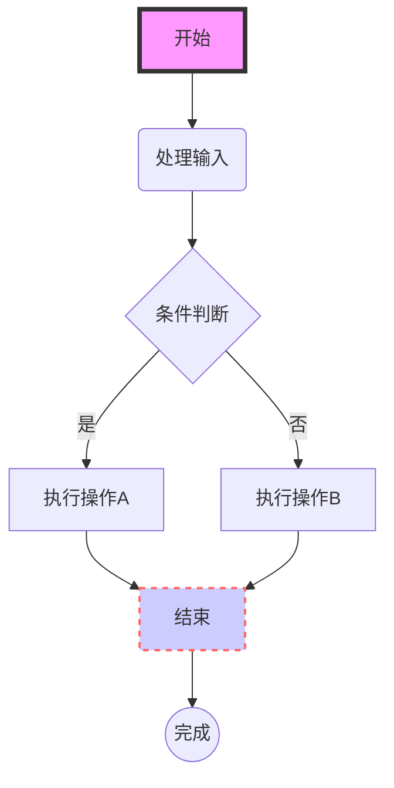
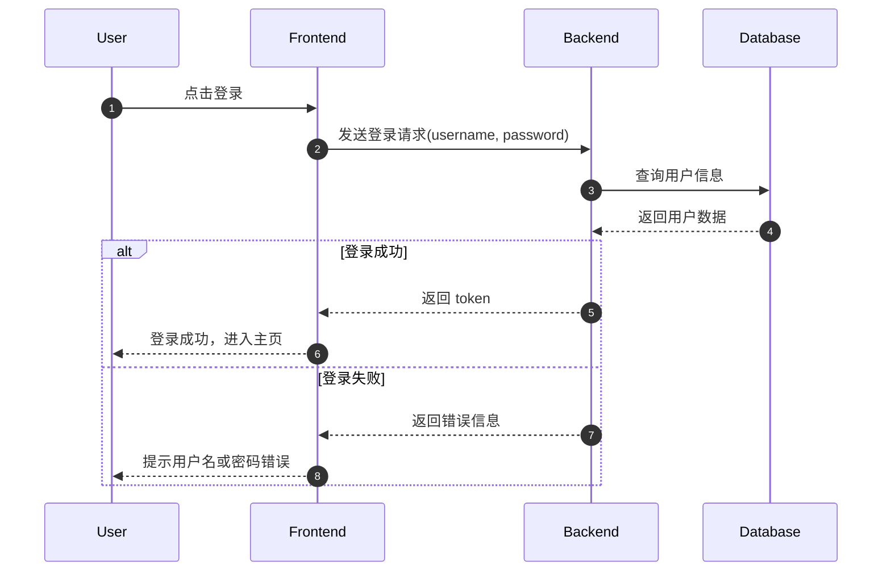
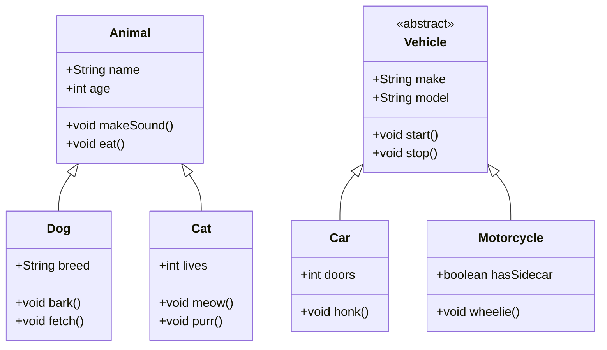
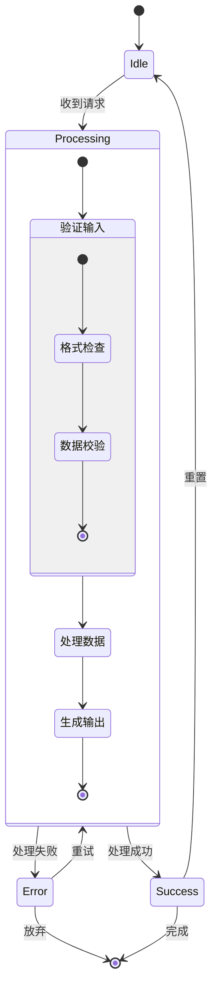
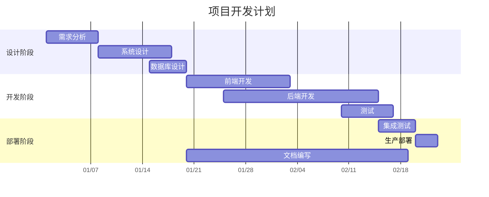
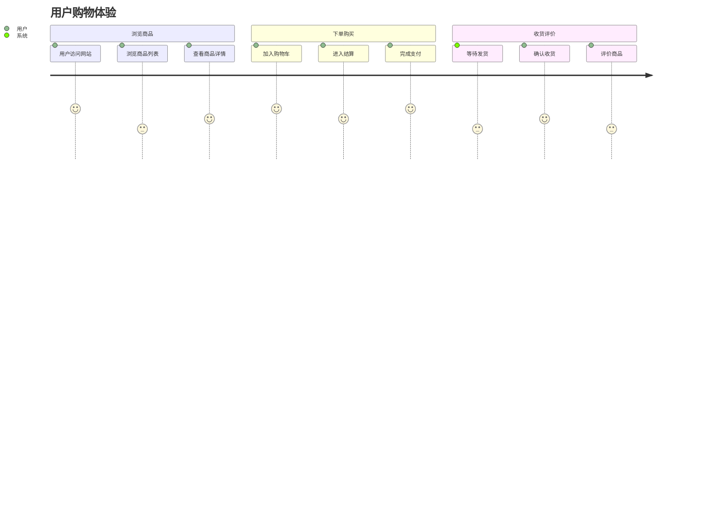
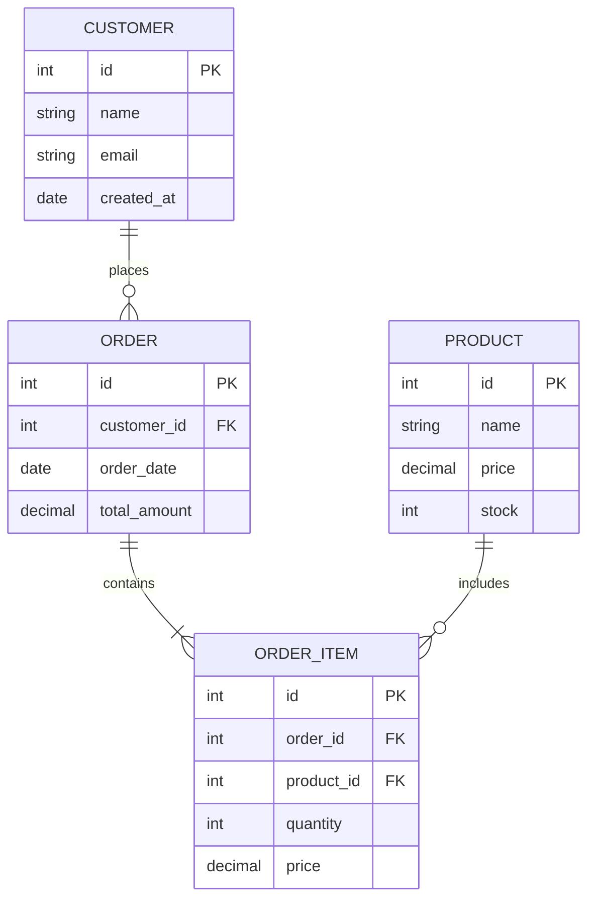
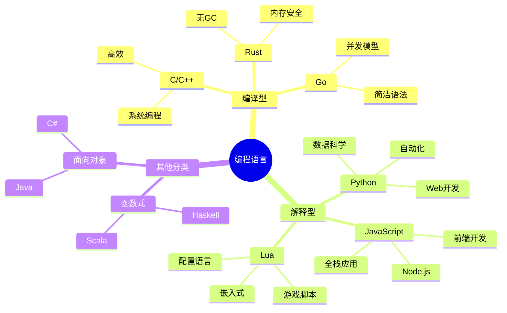

# Markdown 语法全面测试文档

这是一个用于测试 Markdown 渲染引擎的综合性测试文件，包含了所有标准的 Markdown 语法元素、扩展语法、代码块、数学公式和各种嵌入式内容。

## 1. 基础文本格式化

### 1.1 标题级别
# 一级标题
## 二级标题
### 三级标题
#### 四级标题
##### 五级标题
###### 六级标题

### 1.2 强调和斜体
这是**粗体文本**，这是*斜体文本*，这是***粗斜体文本***，这是~~删除线文本~~。

### 1.3 下划线和高亮
这是<u>下划线文本</u>，这是==高亮文本==。

## 2. 列表

### 2.1 无序列表
- 第一项
- 第二项
  - 嵌套项
  - 另一个嵌套项
- 第三项
  * 使用星号
  + 使用加号

### 2.2 有序列表
1. 第一项
2. 第二项
   1. 嵌套第一项
   2. 嵌套第二项
3. 第三项

### 2.3 任务列表
- [ ] 未完成任务
- [x] 已完成任务
- [ ] 另一个任务
  - [x] 嵌套的已完成任务

### 2.4 定义列表
Markdown
: 一种轻量级标记语言

Git
: 分布式版本控制系统

VSCode
: 跨平台代码编辑器

## 3. 链接和引用

### 3.1 链接
[内联链接](https://example.com)
[带标题的链接](https://example.com "示例网站")
[引用链接][1]
[相对链接](../docs/README.md)

[1]: https://example.com "参考链接示例"

### 3.2 自动链接
<https://example.com>
<contact@example.com>

### 3.3 脚注
这是一个带有脚注的句子。[1](@ref)另一个引用。[2](@ref)

[1](@ref): 这是第一个脚注的内容，可以包含多行文本。
[2](@ref): 第二个脚注，也可以包含**格式化的文本**。

## 4. 图片和多媒体

### 4.1 图片


### 4.2 带链接的图片
[](https://example.com)

## 5. 代码

### 5.1 行内代码
在段落中使用`inline code`，比如`print("Hello World")`。

### 5.2 代码块

```python
Python代码示例
import math
from typing import List, Optional
def fibonacci(n: int) -> List[int]:
"""
生成斐波那契数列
"""
if n <= 0:
return []
elif n == 1:
return [0]
sequence = [0, 1]
for i in range(2, n):
    sequence.append(sequence[i-1] + sequence[i-2])

return sequence
class DataPoint:
"""数据点类"""
def init(self, x: float, y: float, label: Optional[str] = None):
self.x = x
self.y = y
self.label = label
def distance_to(self, other: 'DataPoint') -> float:
    return math.sqrt((self.x - other.x)**2 + (self.y - other.y)**2)

def __repr__(self) -> str:
    return f"DataPoint({self.x}, {self.y}, label={self.label})"
使用示例
if name== "main":
points = [DataPoint(i, i**2, f"p{i}") for i in range(5)]
print(f"Points: {points}")
print(f"Fibonacci: {fibonacci(10)}")
```
```cpp
// C++代码示例
include <iostream>
include <vector>
include <memory>
include <cmath>
namespace Geometry {
class Point {
private:
    double x, y;
    
public:
    Point(double x = 0.0, double y = 0.0) : x(x), y(y) {}
    
    double distanceTo(const Point& other) const {
        return std::sqrt(std::pow(x - other.x, 2) + std::pow(y - other.y, 2));
    }
    
    double getX() const { return x; }
    double getY() const { return y; }
    
    void setX(double newX) { x = newX; }
    void setY(double newY) { y = newY; }
    
    virtual std::string toString() const {
        return "Point(" + std::to_string(x) + ", " + std::to_string(y) + ")";
    }
};

class Shape {
public:
    virtual double area() const = 0;
    virtual double perimeter() const = 0;
    virtual ~Shape() = default;
};

class Circle : public Shape {
private:
    Point center;
    double radius;
    
public:
    Circle(const Point& center, double radius) 
        : center(center), radius(radius) {
        if (radius < 0) {
            throw std::invalid_argument("Radius cannot be negative");
        }
    }
    
    double area() const override {
        return M_PI * radius * radius;
    }
    
    double perimeter() const override {
        return 2 * M_PI * radius;
    }
};
}
int main() {
using Geometry::Point;
using Geometry::Circle;
Point p1(1.0, 2.0);
Point p2(4.0, 6.0);

std::cout << "Distance: " << p1.distanceTo(p2) << std::endl;

Circle c(p1, 5.0);
std::cout << "Circle area: " << c.area() << std::endl;
std::cout << "Circle perimeter: " << c.perimeter() << std::endl;

return 0;
}
```

```rust
// Rust代码示例
use std::fmt;
use std::error::Error;
[derive(Debug, Clone, PartialEq)]
pub enum HttpStatus {
Ok = 200,
NotFound = 404,
InternalServerError = 500,
}
impl HttpStatus {
pub fn from_code(code: u16) -> Option<Self> {
match code {
200 => Some(HttpStatus::Ok),
404 => Some(HttpStatus::NotFound),
500 => Some(HttpStatus::InternalServerError),
_ => None,
}
}
pub fn reason_phrase(&self) -> &'static str {
    match self {
        HttpStatus::Ok => "OK",
        HttpStatus::NotFound => "Not Found",
        HttpStatus::InternalServerError => "Internal Server Error",
    }
}
}
[derive(Debug)]
pub struct HttpResponse {
status: HttpStatus,
headers: Vec<(String, String)>,
body: Option<String>,
}
impl HttpResponse {
pub fn new(status: HttpStatus) -> Self {
Self {
status,
headers: Vec::new(),
body: None,
}
}
pub fn with_body(mut self, body: String) -> Self {
    self.body = Some(body);
    self
}

pub fn add_header(mut self, key: &str, value: &str) -> Self {
    self.headers.push((key.to_string(), value.to_string()));
    self
}

pub fn to_string(&self) -> String {
    let mut response = format!(
        "HTTP/1.1 {} {}\r\n",
        self.status as u16,
        self.status.reason_phrase()
    );
    
    for (key, value) in &self.headers {
        response.push_str(&format!("{}: {}\r\n", key, value));
    }
    
    if let Some(body) = &self.body {
        response.push_str(&format!("Content-Length: {}\r\n", body.len()));
        response.push_str("\r\n");
        response.push_str(body);
    } else {
        response.push_str("\r\n");
    }
    
    response
}
}
fn process_request() -> Result<HttpResponse, Box<dyn Error>> {
let response = HttpResponse::new(HttpStatus::Ok)
.with_body("{"message": "Hello, World!"}".to_string())
.add_header("Content-Type", "application/json");
Ok(response)
}
fn main() {
match process_request() {
Ok(response) => println!("Response:\n{}", response.to_string()),
Err(e) => eprintln!("Error: {}", e),
}
}
```

```c
// C代码示例
include <stdio.h>
include <stdlib.h>
include <string.h>
include <math.h>
define MAX_STRING_LEN 256
define PI 3.14159265358979323846
typedef struct {
double x;
double y;
} Point;
typedef struct {
Point center;
double radius;
} Circle;
typedef struct {
Point vertices[3];
} Triangle;
double distance(Point a, Point b) {
return sqrt(pow(a.x - b.x, 2) + pow(a.y - b.y, 2));
}
double circle_area(Circle c) {
return PI * c.radius * c.radius;
}
double circle_circumference(Circle c) {
return 2 * PI * c.radius;
}
double triangle_area(Triangle t) {
double a = distance(t.vertices[0], t.vertices[1]);
double b = distance(t.vertices[1], t.vertices[2]);
double c = distance(t.vertices[2], t.vertices[0]);
double s = (a + b + c) / 2.0;
if (s <= a || s <= b || s <= c) {
    return 0.0;
}

return sqrt(s * (s - a) * (s - b) * (s - c));
}
void process_string(const char* input, char* output) {
int len = strlen(input);
int j = 0;
for (int i = 0; i < len; i++) {
    if ((input[i] >= 'a' && input[i] <= 'z') || 
        (input[i] >= 'A' && input[i] <= 'Z') ||
        (input[i] >= '0' && input[i] <= '9') ||
        input[i] == ' ') {
        output[j++] = input[i];
    }
}
output[j] = '\0';
}
int main() {
Point p1 = {0.0, 0.0};
Point p2 = {3.0, 4.0};
printf("Distance between points: %.2f\n", distance(p1, p2));

Circle c = {p1, 5.0};
printf("Circle area: %.2f\n", circle_area(c));
printf("Circle circumference: %.2f\n", circle_circumference(c));

Triangle t = {{{0.0, 0.0}, {4.0, 0.0}, {0.0, 3.0}}};
printf("Triangle area: %.2f\n", triangle_area(t));

char input[] = "Hello, World! 123";
char output[MAX_STRING_LEN];

process_string(input, output);
printf("Filtered string: %s\n", output);

return 0;
}
```

```bash
!/bin/bash
Bash脚本示例
这是一个多功能的系统信息脚本
set -euo pipefail
颜色定义
RED='\033[0;31m'
GREEN='\033[0;32m'
YELLOW='\033[1;33m'
BLUE='\033[0;34m'
NC='\033[0m' # No Color
日志函数
log_info() {
echo -e "BLUE[INFO]{NC} $1"
}
log_success() {
echo -e "GREEN[SUCCESS]{NC} $1"
}
log_warning() {
echo -e "YELLOW[WARNING]{NC} $1"
}
log_error() {
echo -e "RED[ERROR]{NC} $1" >&2
}
系统信息收集
get_system_info() {
log_info "收集系统信息..."
local os_info
if [[ -f /etc/os-release ]]; then
    os_info=$(grep PRETTY_NAME /etc/os-release | cut -d= -f2 | tr -d '"')
elif [[ $(uname) == "Darwin" ]]; then
    os_info=$(sw_vers -productName)
else
    os_info=$(uname -s)
fi

local kernel_version=$(uname -r)
local arch=$(uname -m)
local hostname=$(hostname)
local uptime=$(uptime -p 2>/dev/null || uptime)

echo "操作系统: $os_info"
echo "内核版本: $kernel_version"
echo "系统架构: $arch"
echo "主机名称: $hostname"
echo "运行时间: $uptime"
}
```

```lua
-- Lua代码示例
-- 简单的配置解析器
local M = {}
M.default_config = {
port = 8080,
host = "127.0.0.1",
timeout = 30,
max_connections = 100,
debug = false,
log_level = "info"
}
function M.parse_config(filename)
local config = {}
-- 设置默认值
for k, v in pairs(M.default_config) do
    config[k] = v
end

local file = io.open(filename, "r")
if not file then
    return config
end

for line in file:lines() do
    -- 移除注释
    local clean_line = line:match("^([^#]+)") or line
    clean_line = clean_line:match("^%s*(.-)%s*$")  -- 去除首尾空白
    
    if #clean_line > 0 then
        local key, value = clean_line:match("^([%w_]+)%s*=%s*(.+)$")
        if key and value then
            -- 转换值类型
            if value == "true" then
                config[key] = true
            elseif value == "false" then
                config[key] = false
            elseif tonumber(value) then
                config[key] = tonumber(value)
            else
                -- 移除字符串引号
                config[key] = value:gsub("^['\"](.*)['\"]$", "%1")
            end
        end
    end
end

file:close()
return config
end
function M.validate_config(config)
local required_fields = {"port", "host"}
for _, field in ipairs(required_fields) do
    if config[field] == nil then
        return false, string.format("Missing required field: %s", field)
    end
end

if type(config.port) ~= "number" or config.port < 1 or config.port > 65535 then
    return false, "Port must be a number between 1 and 65535"
end

if type(config.max_connections) ~= "number" or config.max_connections < 1 then
    return false, "max_connections must be a positive number"
end

return true
end
function M.print_config(config)
print("Current configuration:")
print(string.rep("-", 40))
local keys = {}
for k in pairs(config) do
    table.insert(keys, k)
end
table.sort(keys)

for _, key in ipairs(keys) do
    print(string.format("%-20s = %s", key, tostring(config[key])))
end
print(string.rep("-", 40))
end
-- 使用示例
if arg and arg[1] then
local config = M.parse_config(arg[1])
local valid, err = M.validate_config(config)
if valid then
    M.print_config(config)
else
    print("Configuration error:", err)
end
end
return M
```

## 6. 表格

### 6.1 基本表格
| 姓名 | 年龄 | 职业 |
|------|------|------|
| 张三 | 25  | 工程师 |
| 李四 | 30  | 设计师 |
| 王五 | 28  | 产品经理 |

### 6.2 对齐表格
| 左对齐 | 居中对齐 | 右对齐 |
|:-------|:--------:|-------:|
| 左对齐文本 | 居中文本 | 右对齐文本 |
| 另一行 | 更多内容 | 数字123 |

### 6.3 复杂表格
| 项目 | 描述 | 状态 | 优先级 | 完成日期 |
|------|------|------|--------|----------|
| 功能A | 实现用户登录 | ✅ 完成 | 高 | 2024-01-15 |
| 功能B | 添加支付功能 | 🔄 进行中 | 中 | 2024-02-01 |
| 功能C | 优化性能 | ⏳ 待开始 | 高 | 2024-02-15 |
| 功能D | 文档编写 | ❌ 取消 | 低 | - |

## 7. 引用块

### 7.1 基本引用
> 这是一个引用块。
> 可以包含多行文本。

### 7.2 嵌套引用
> 第一层引用
>> 第二层引用
>>> 第三层引用
>
> 回到第一层

### 7.3 包含其他元素的引用
> ## 引用中的标题
> 
> 引用中的**加粗文本**和`行内代码`
> 
> 1. 引用中的列表
> 2. 第二项
> 
> | 表格 | 示例 |
> |------|------|
> | 单元格1 | 单元格2 |

## 8. 水平分割线

### 8.1 各种分割线写法
---

***

*****

- - -

---

## 9. 数学公式

### 9.1 行内数学公式
这是行内公式：$E = mc^2$，以及$\int_a^b f(x) dx = F(b) - F(a)$。

### 9.2 块级数学公式
#### 麦克斯韦方程组
$$
\begin{aligned}
\nabla \cdot \mathbf{E} &= \frac{\rho}{\varepsilon_0} \\
\nabla \cdot \mathbf{B} &= 0 \\
\nabla \times \mathbf{E} &= -\frac{\partial \mathbf{B}}{\partial t} \\
\nabla \times \mathbf{B} &= \mu_0 \mathbf{J} + \mu_0 \varepsilon_0 \frac{\partial \mathbf{E}}{\partial t}
\end{aligned}
$$

#### 薛定谔方程
$$
i\hbar \frac{\partial}{\partial t} \Psi(\mathbf{r}, t) = \hat{H} \Psi(\mathbf{r}, t)
$$

其中：

$$
\hat{H} = -\frac{\hbar^2}{2m} \nabla^2 + V(\mathbf{r})
$$

#### 欧拉公式
$$
e^{i\theta} = \cos\theta + i\sin\theta
$$

#### 质能方程
$$
E = \sqrt{(pc)^2 + (m_0c^2)^2}
$$

## 10. Mermaid 图表

### 10.1 流程图



### 10.2 时序图



### 10.3 类图



### 10.4 状态图



### 10.5 甘特图



### 10.7 用户旅程图



### 10.8 象限图


### 10.9 实体关系图



### 10.10 思维导图



## 11. 其他元素

### 11.1 脚注
这里有一个脚注引用[1](@ref)，这里有两个脚注引用[2](@ref)。

[1](@ref): 这是第一个详细的脚注内容，可以解释前文的某些概念。
[2](@ref): 第二个脚注，可以包含**格式化文本**、`代码`或其他[链接](https://example.com)。

### 11.2 任务列表
- [x] 完成Markdown基础语法测试
- [x] 添加所有代码示例
- [x] 包含数学公式
- [ ] 测试Mermaid图表渲染
- [ ] 验证表格格式化
- [ ] 检查所有链接

### 11.3 表情符号
这是表情符号测试：🚀 ⚡ 🔥 💻 📱 🎨 📊 📈 📉 ✅ ❌ ⚠️ ℹ️

### 11.4 上标和下标
水的化学式：H~2~O
爱因斯坦质能方程：E = mc^2^
勾股定理：a^2^ + b^2^ = c^2^

## 12. 特殊字符

### 12.1 HTML实体
&lt; &gt; &amp; &copy; &reg; &trade; &nbsp; &quot; &apos; &cent; &pound; &yen; &euro; &sect;

### 12.2 转义字符
\* 星号 \_ 下划线 \` 反引号 \~ 波浪线 \# 井号 \+ 加号 \- 减号 \. 点 \( 左括号 \) 右括号 \[ 左中括号 \] 右中括号 \{ 左大括号 \} 右大括号

## 13. 扩展语法测试

### 13.1 目录（TOC）
[TOC]

### 13.2 注音符号
Markdown: 标记{márkdəʊn}语言
中文: 中文{zhōngwén}

### 13.3 下标和上标
H~2~O
x^2^ + y^2^ = z^2^

## 14. 综合测试段落

这是一个**综合性测试段落**，包含了*多种* Markdown 元素。例如，这里有`行内代码`，有[链接](https://example.com)，有**加粗**和*斜体*，还有~~删除线~~。

> 这是一个引用块，内部也可以包含**格式化文本**和`代码`。

列表测试：
- 第一项包含`代码`
- 第二项包含**粗体**
- 第三项包含*斜体*

表格测试：

| 功能 | 状态 | 测试日期 |
|------|------|----------|
| 标题 | ✅ | 2024-01-01 |
| 列表 | ✅ | 2024-01-01 |
| 代码块 | ✅ | 2024-01-01 |
| 表格 | ⚠️ | 2024-01-01 |
| 数学公式 | ❌ | 2024-01-01 |

数学公式行内测试：$f(x) = \int_{-\infty}^{\infty} \hat{f}(\xi) e^{2 \pi i \xi x} d\xi$

代码块测试：
```javascript
// JavaScript示例
console.log("Hello, World!");
```

## 15. 复杂表格示例

| 项目 | 描述 | 状态 | 进度 | 负责人 | 截止日期 |
|------|------|------|------|--------|----------|
| 用户认证 | 实现OAuth 2.0和JWT | 🔄 进行中 | 75% | 张三 | 2024-02-15 |
| 支付集成 | 集成Stripe和PayPal | ✅ 完成 | 100% | 李四 | 2024-01-30 |
| 性能优化 | 数据库查询优化 | ⏳ 计划中 | 0% | 王五 | 2024-03-01 |
| 移动端适配 | 响应式设计改进 | 🔄 进行中 | 60% | 赵六 | 2024-02-28 |
| 文档编写 | API文档和用户手册 | 🚫 阻塞 | 30% | 钱七 | 2024-02-20 |

## 16. 测试数据

### 16.1 长文本测试
Lorem ipsum dolor sit amet, consectetur adipiscing elit. Sed do eiusmod tempor incididunt ut labore et dolore magna aliqua. Ut enim ad minim veniam, quis nostrud exercitation ullamco laboris nisi ut aliquip ex ea commodo consequat. Duis aute irure dolor in reprehenderit in voluptate velit esse cillum dolore eu fugiat nulla pariatur. Excepteur sint occaecat cupidatat non proident, sunt in culpa qui officia deserunt mollit anim id est laborum.

### 16.2 混合内容测试
这是一个**混合内容**的段落，包含：
1. 有序列表项
2. 另一个列表项
   - 嵌套无序列表
   - 更多嵌套
3. 回到有序列表

> 引用中的**混合内容**：
> 1. 引用中的有序列表
> 2. 继续
>   - 嵌套
>   - 更多

`行内代码`在段落中，还有数学公式：$a^2 + b^2 = c^2$

| 表头1 | 表头2 |
|-------|-------|
| 单元格1 | 单元格2 |

## 17. 结束语

这个文档包含了**所有主要的Markdown语法**，包括：

1. **基础语法**：标题、强调、列表、链接、图片
2. **扩展语法**：表格、任务列表、脚注、定义列表
3. **代码块**：多种编程语言
4. **数学公式**：行内和块级公式
5. **Mermaid图表**：所有图表类型
6. **特殊字符和格式**：上标、下标、转义字符

测试完成后，请检查以下方面：
- [ ] 所有标题是否正确渲染
- [ ] 列表嵌套是否正确
- [ ] 代码高亮是否正常
- [ ] 表格边框和对齐
- [ ] 数学公式渲染
- [ ] Mermaid图表显示
- [ ] 链接和图片加载
- [ ] 引用块格式
- [ ] 特殊字符处理

---

*测试文档结束*